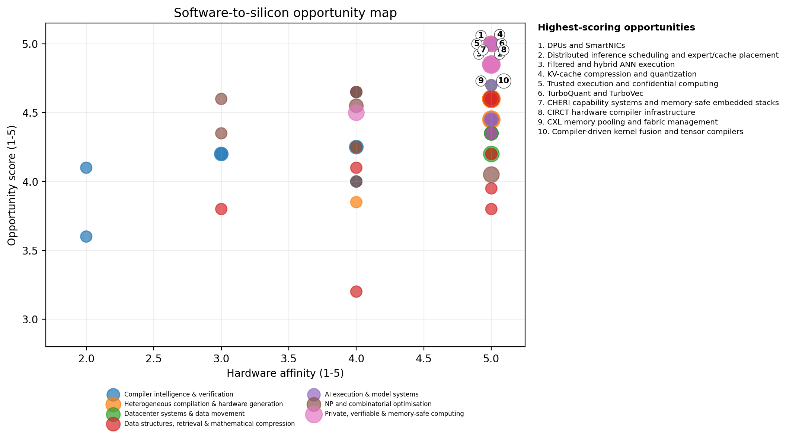

# 1. Executive assessment

The most valuable software-to-hardware opportunities share four traits: they expose mathematical structure, reduce data movement, provide a retargetable intermediate representation, and preserve a correctness or quality contract. Raw “acceleration” is rarely the moat. The moat is the representation that makes acceleration repeatable across workloads and hardware generations.

| **Thesis**                                   | **Why it matters**                                                                                                               | **Representative technologies**                                          |
|----------------------------------------------|----------------------------------------------------------------------------------------------------------------------------------|--------------------------------------------------------------------------|
| 1\. Move semantics upward                    | Retaining domain meaning longer lets compilers make hardware-aware choices instead of recovering intent from low-level code.     | MLIR, CIRCT, TVM, TACO, Halide, solver-aided DSLs                        |
| 2\. Treat bytes moved as the scarce resource | Modern systems are frequently limited by HBM, DRAM, PCIe, storage or network traffic rather than arithmetic.                     | FlashAttention, TurboVec, PIM, computational storage, CXL, zero-copy I/O |
| 3\. Make hard search structured              | NP-hardness remains, but reductions, relaxations, learning and hardware batching can transform practical instance distributions. | CDCL, CP-SAT, GPU B&B, FPT, approximation, QUBO                          |
| 4\. Carry evidence with the result           | Proofs, certificates, slices and attestation make aggressive automation deployable in high-stakes systems.                       | Type slicing, translation validation, PCC, ZK, TEEs, CHERI               |

**The strongest near-term software-first bets.** Hardware-aware equality saturation; type/provenance slicing for code agents; filtered compressed vector search; sparse tensor/dataflow compilation; GPU-batched exact optimisation; CXL-aware memory orchestration; and privacy proof/crypto compilers. These can begin as software, generate proprietary workload data and cost models, then move hot paths into FPGAs, DPUs or ASICs.

**The strongest capital-intensive bets.** Near-memory compute, computational storage, custom vector-search silicon, FHE/ZK accelerators, capability-secure processors and reconfigurable accelerator fabrics. Each needs a software wedge first; silicon without a compiler, runtime and workload channel is not a business.

Figure 1. Opportunity score combines novelty, hardware affinity, software wedge, defensibility and commercial timing. Bubble size represents capital intensity.

## Five conclusions

> **Software is the entry point even for silicon businesses.** The scalable sequence is usually: reference implementation -\> profiler/cost model -\> compiler/runtime -\> FPGA/DPU prototype -\> ASIC only after recurring workloads are proven.
>
> **P versus NP is a product-design constraint, not a marketing slogan.** For P workloads, improve asymptotics, locality, precision or parallelism. For NP-hard workloads, exploit structure, reduce instances, approximate, learn heuristics or accelerate bounded subroutines while preserving certificates.
>
> **Data movement is the unifying economic problem.** Vector compression, sparse formats, direct I/O, CXL, DPUs, attention tiling and sharded training all monetise reduced movement more than additional FLOPS.
>
> **Explanations and proofs are becoming infrastructure.** As code-generation and optimisation agents become stronger, minimal causal context, translation validation and deployment certificates become control surfaces rather than academic extras.
>
> **The best moat is a feedback loop.** The defensible company continuously learns real hardware costs, workload distributions, solver behaviour and failure cases, then updates its compiler, schedule or model.
