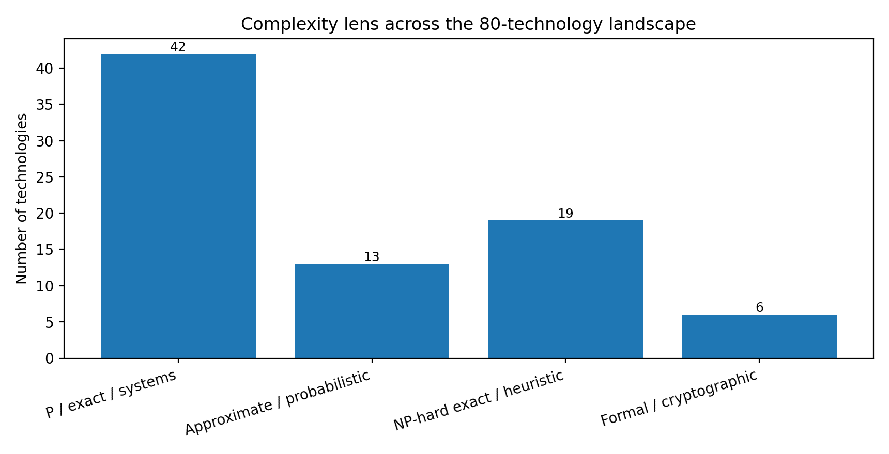

# 2. How the P/NP lens is used

Hardware changes constants, parallelism, memory traffic and the size of instances that are practical. It does not turn a general NP-complete problem into a polynomial-time problem unless P = NP. The dossier therefore distinguishes five legitimate forms of leverage:

**P-exact:** Compute the same mathematical result with better asymptotics, locality, precision selection or parallel execution.

**P-approximate/probabilistic:** Trade exactness for explicit error, recall or probability guarantees; compress data so the hardware does less work.

**NP-exact:** Use SAT, CP, MILP or branch-and-bound to retain certificates, while accelerating propagation, relaxations, bounds or portfolios.

**NP-structured:** Use fixed parameters, kernelization, decomposition or restricted instances to move exponential cost into a small structural quantity.

**NP-approximate/heuristic:** Use provable approximation, learned policies or annealing where optimality is not required; measure gap and feasibility honestly.

Figure 2. Classification is deliberately pragmatic: many systems combine several lenses.

## A practical test for “hardware-scalable” software

| **Question**                                         | **Positive signal**                                                                                       |
|------------------------------------------------------|-----------------------------------------------------------------------------------------------------------|
| **Does the algorithm expose regular parallel work?** | Batched matrix/vector operations, table lookups, bit operations, scans, FFT/NTT, reductions or pipelines. |
| **Is data movement visible and controllable?**       | Explicit layouts, memory scopes, compression, tiling, streaming or zero-copy boundaries.                  |
| **Can correctness or quality be checked cheaply?**   | Proof certificate, verifier, bounded error, recall metric, optimality gap or reference implementation.    |
| **Can software collect proprietary feedback?**       | Cost models, rewrite outcomes, solver traces, hardware counters and customer workload distributions.      |
| **Is there a staged capital path?**                  | CPU/GPU library first, then FPGA/DPU prototype, then ASIC only after repeatable volume.                   |
