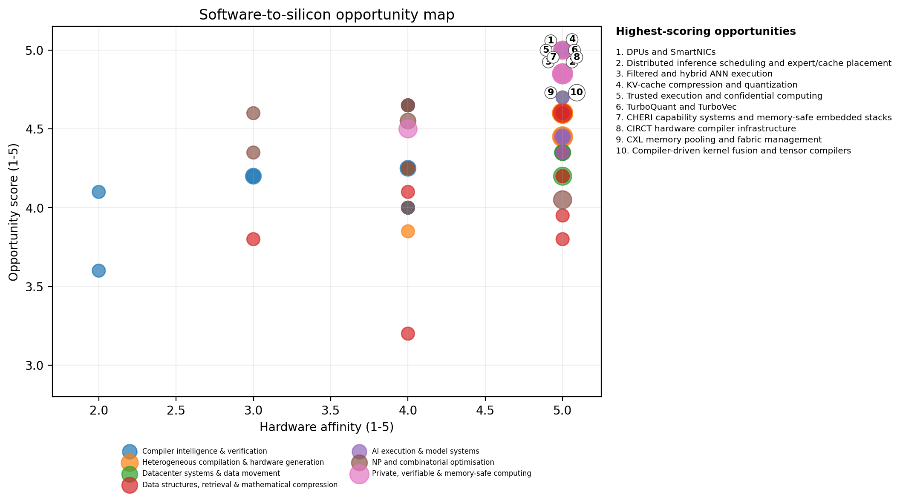
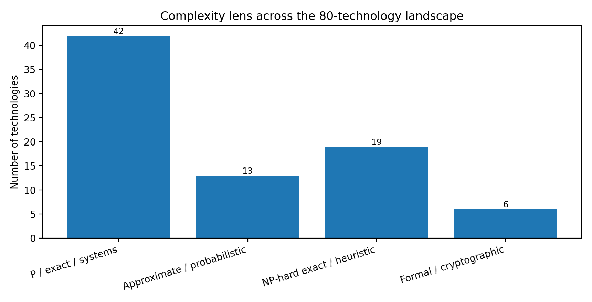

**SOFTWARE-TO-SILICON**

**INNOVATION DOSSIER**

80 software technologies with credible paths into CPUs, GPUs, FPGAs, ASICs and datacenter fabrics

<table>
<colgroup>
<col style="width: 25%" />
<col style="width: 25%" />
<col style="width: 25%" />
<col style="width: 25%" />
</colgroup>
<thead>
<tr class="header">
<th><strong>80 
</strong>technologies</th>
<th><strong>7 
</strong>landscape domains</th>
<th><strong>P / NP 
</strong>complexity lens</th>
<th><strong>2026 
</strong>research cut-off</th>
</tr>
</thead>
<tbody>
</tbody>
</table>

**Prepared for Arya Arun**

Strategic research dossier - 23 July 2026

# Contents

**1** Executive assessment

**2** How the P/NP lens is used

**3** What the two seed examples reveal

**4** Portfolio matrix: all 80 technologies

**5** Priority opportunities

**6** Detailed technology profiles

**7** Build and commercialisation roadmap

**8** Risk framework and diligence questions

**9** Reference library

**Scope note.** This is a strategic technology landscape, not investment advice or a claim that any system defeats worst-case complexity. Scores are judgement-based and intended to compare opportunities consistently, not to imply scientific precision.

# 1. Executive assessment

The most valuable software-to-hardware opportunities share four traits: they expose mathematical structure, reduce data movement, provide a retargetable intermediate representation, and preserve a correctness or quality contract. Raw “acceleration” is rarely the moat. The moat is the representation that makes acceleration repeatable across workloads and hardware generations.

| **Thesis**                                   | **Why it matters**                                                                                                               | **Representative technologies**                                          |
|----------------------------------------------|----------------------------------------------------------------------------------------------------------------------------------|--------------------------------------------------------------------------|
| 1\. Move semantics upward                    | Retaining domain meaning longer lets compilers make hardware-aware choices instead of recovering intent from low-level code.     | MLIR, CIRCT, TVM, TACO, Halide, solver-aided DSLs                        |
| 2\. Treat bytes moved as the scarce resource | Modern systems are frequently limited by HBM, DRAM, PCIe, storage or network traffic rather than arithmetic.                     | FlashAttention, TurboVec, PIM, computational storage, CXL, zero-copy I/O |
| 3\. Make hard search structured              | NP-hardness remains, but reductions, relaxations, learning and hardware batching can transform practical instance distributions. | CDCL, CP-SAT, GPU B&B, FPT, approximation, QUBO                          |
| 4\. Carry evidence with the result           | Proofs, certificates, slices and attestation make aggressive automation deployable in high-stakes systems.                       | Type slicing, translation validation, PCC, ZK, TEEs, CHERI               |

**The strongest near-term software-first bets.** Hardware-aware equality saturation; type/provenance slicing for code agents; filtered compressed vector search; sparse tensor/dataflow compilation; GPU-batched exact optimisation; CXL-aware memory orchestration; and privacy proof/crypto compilers. These can begin as software, generate proprietary workload data and cost models, then move hot paths into FPGAs, DPUs or ASICs.

**The strongest capital-intensive bets.** Near-memory compute, computational storage, custom vector-search silicon, FHE/ZK accelerators, capability-secure processors and reconfigurable accelerator fabrics. Each needs a software wedge first; silicon without a compiler, runtime and workload channel is not a business.

Figure 1. Opportunity score combines novelty, hardware affinity, software wedge, defensibility and commercial timing. Bubble size represents capital intensity.

## Five conclusions

> **Software is the entry point even for silicon businesses.** The scalable sequence is usually: reference implementation -\> profiler/cost model -\> compiler/runtime -\> FPGA/DPU prototype -\> ASIC only after recurring workloads are proven.
>
> **P versus NP is a product-design constraint, not a marketing slogan.** For P workloads, improve asymptotics, locality, precision or parallelism. For NP-hard workloads, exploit structure, reduce instances, approximate, learn heuristics or accelerate bounded subroutines while preserving certificates.
>
> **Data movement is the unifying economic problem.** Vector compression, sparse formats, direct I/O, CXL, DPUs, attention tiling and sharded training all monetise reduced movement more than additional FLOPS.
>
> **Explanations and proofs are becoming infrastructure.** As code-generation and optimisation agents become stronger, minimal causal context, translation validation and deployment certificates become control surfaces rather than academic extras.
>
> **The best moat is a feedback loop.** The defensible company continuously learns real hardware costs, workload distributions, solver behaviour and failure cases, then updates its compiler, schedule or model.

# 2. How the P/NP lens is used

Hardware changes constants, parallelism, memory traffic and the size of instances that are practical. It does not turn a general NP-complete problem into a polynomial-time problem unless P = NP. The dossier therefore distinguishes five legitimate forms of leverage:

**P-exact:** Compute the same mathematical result with better asymptotics, locality, precision selection or parallel execution.

**P-approximate/probabilistic:** Trade exactness for explicit error, recall or probability guarantees; compress data so the hardware does less work.

**NP-exact:** Use SAT, CP, MILP or branch-and-bound to retain certificates, while accelerating propagation, relaxations, bounds or portfolios.

**NP-structured:** Use fixed parameters, kernelization, decomposition or restricted instances to move exponential cost into a small structural quantity.

**NP-approximate/heuristic:** Use provable approximation, learned policies or annealing where optimality is not required; measure gap and feasibility honestly.

Figure 2. Classification is deliberately pragmatic: many systems combine several lenses.

## A practical test for “hardware-scalable” software

| **Question**                                         | **Positive signal**                                                                                       |
|------------------------------------------------------|-----------------------------------------------------------------------------------------------------------|
| **Does the algorithm expose regular parallel work?** | Batched matrix/vector operations, table lookups, bit operations, scans, FFT/NTT, reductions or pipelines. |
| **Is data movement visible and controllable?**       | Explicit layouts, memory scopes, compression, tiling, streaming or zero-copy boundaries.                  |
| **Can correctness or quality be checked cheaply?**   | Proof certificate, verifier, bounded error, recall metric, optimality gap or reference implementation.    |
| **Can software collect proprietary feedback?**       | Cost models, rewrite outcomes, solver traces, hardware counters and customer workload distributions.      |
| **Is there a staged capital path?**                  | CPU/GPU library first, then FPGA/DPU prototype, then ASIC only after repeatable volume.                   |

# 3. What the two seed examples reveal

## 3.1 Polymorphic type slicing: explanation as a computational primitive

The Cambridge work formalises a system in which a programmer selects a sub-term and a component of its type, then receives a minimal source slice explaining either what inside the term produced that type or what surrounding context required it. The paper also draws the exact boundary requested in this dossier: useful term-minimal slices can be calculated in polynomial time, while globally minimum-size slicing is NP-hard through a reduction from set cover.

**Commercial translation:** Build an “explanation graph” beneath an IDE or coding agent. It can constrain refactors, isolate the context sent to an LLM, explain non-local errors and record why generated changes are permitted.

**Hardware path:** Initially weak: this is a software/compiler product. At fleet scale, persistent derivation graphs, incremental fixed points and parallel provenance queries could move to graph accelerators or DPUs, but hardware should follow adoption rather than lead it.

**Strategic lesson:** A mathematically defined minimal explanation can be both a developer feature and an enforcement boundary for automated code modification.

## 3.2 TurboQuant/TurboVec: distributional mathematics translated into packed hardware work

TurboVec is a particularly instructive software-to-silicon pattern. It normalises vectors, applies a random orthogonal rotation, quantises predictable coordinate marginals into 2- or 4-bit codes, and scores packed vectors directly through lookup tables. The repository implements architecture-specific NEON and AVX paths, avoids a separate codebook-training phase and integrates filtering into block-level scoring.

**Commercial translation:** Start as a fast local vector library; expand into embedded indexes, private RAG, filtered retrieval and SSD/CXL-resident search; move stable scoring kernels into FPGA, DPU or ASIC IP.

**Why the mathematics matters:** The rotation and known marginal distribution simplify training and make the representation data-oblivious, while bit packing changes the bottleneck from floating-point bandwidth to compact table lookup and accumulation.

**Strategic lesson:** The best acceleration ideas often combine a theorem or distributional invariant, a compressed representation, and an implementation layout that maps directly to instructions and memory blocks.

# 4. Portfolio matrix: all 80 technologies

The score is a directional prioritisation tool, not a forecast. A score above 4.4 indicates a particularly strong combination of technical leverage and plausible commercial timing. Capital intensity is shown separately so software-first and silicon-heavy opportunities are not conflated.

## Compiler intelligence & verification

| **\#** | **Technology**                                   | **Complexity lens**                                               | **Score** | **Capital** | **HW fit** |
|--------|--------------------------------------------------|-------------------------------------------------------------------|-----------|-------------|------------|
| 8      | CIRCT hardware compiler infrastructure           | P transformations plus NP-hard synthesis subproblems              | 4.85      | Medium      | 5          |
| 16     | MLIR multi-level intermediate representation     | P compiler infrastructure                                         | 4.85      | Low         | 5          |
| 27     | Equality saturation and e-graphs                 | P-style rewriting with potentially explosive search               | 4.65      | Low         | 4          |
| 29     | Solver-aided programming                         | NP/SMT search hidden behind a language                            | 4.65      | Low         | 4          |
| 48     | Automatic-differentiation compilers              | P transformation of differentiable programs                       | 4.35      | Low         | 5          |
| 57     | Proof-carrying code and certified optimisation   | P checking; proof generation may be hard                          | 4.25      | Medium      | 4          |
| 58     | Superoptimization                                | NP-hard search over program space                                 | 4.25      | Low         | 4          |
| 59     | Syntax-guided synthesis (SyGuS)                  | NP-hard constrained program synthesis                             | 4.25      | Low         | 4          |
| 61     | Verified compilers                               | P compilation with machine-checked correctness                    | 4.20      | Medium      | 3          |
| 65     | Polyhedral compilation                           | P analysis for affine loop nests; optimisation search can be hard | 4.20      | Low         | 5          |
| 67     | Translation validation                           | P/SMT verification per compilation                                | 4.20      | Low         | 3          |
| 70     | Polymorphic type slicing                         | P-exact core; minimum-size variant NP-hard                        | 4.10      | Low         | 2          |
| 72     | Incremental and self-adjusting computation       | P-exact with change-proportional work                             | 4.00      | Low         | 4          |
| 74     | Partial evaluation and multi-stage programming   | P specialisation; code-size trade-offs                            | 4.00      | Low         | 4          |
| 79     | Interactive theorem proving and proof extraction | Logic-dependent; proof checking is tractable                      | 3.60      | Low         | 2          |

## Heterogeneous compilation & hardware generation

| **\#** | **Technology**                                    | **Complexity lens**                                               | **Score** | **Capital** | **HW fit** |
|--------|---------------------------------------------------|-------------------------------------------------------------------|-----------|-------------|------------|
| 1      | DPUs and SmartNICs                                | P packet/storage processing; rule placement may be hard           | 5.00      | High        | 5          |
| 11     | Computational storage                             | P offloaded computation                                           | 4.85      | High        | 5          |
| 18     | Sparse tensor algebra compilation (TACO-class)    | P code generation; format/schedule selection can be combinatorial | 4.85      | Low         | 5          |
| 20     | TVM, MetaSchedule and hardware-native tensor IR   | P compilation with combinatorial schedule search                  | 4.85      | Low         | 5          |
| 21     | Triton and Gluon-style GPU kernel DSLs            | P compilation; schedule tuning search                             | 4.85      | Low         | 5          |
| 30     | Chisel and parameterized RTL generators           | P elaboration; downstream synthesis is hard                       | 4.60      | High        | 5          |
| 32     | Processing-in-memory and near-memory computing    | P computation; system mapping is the innovation                   | 4.60      | Very High   | 5          |
| 33     | RISC-V custom instruction extensions              | P execution; ISA/compiler co-design                               | 4.60      | Very High   | 5          |
| 37     | Systolic and dataflow accelerator generators      | P mapping for regular kernels; design search can be hard          | 4.60      | Very High   | 5          |
| 38     | High-level synthesis (HLS)                        | P compilation with NP-hard scheduling/allocation components       | 4.60      | High        | 5          |
| 42     | CGRA compilers and FPGA overlays                  | NP-hard mapping/routing in general                                | 4.45      | Very High   | 5          |
| 43     | DaCe data-centric compilation                     | P transformations with schedule/search components                 | 4.45      | Low         | 5          |
| 44     | Dynamic FPGA partial reconfiguration              | P orchestration; placement/scheduling can be NP-hard              | 4.45      | High        | 5          |
| 63     | Halide-style separation of algorithm and schedule | P semantics with schedule search                                  | 4.20      | Low         | 5          |
| 76     | Graph DSLs and graph-specific compilation         | P graph algorithms; scheduling/partitioning may be NP-hard        | 3.85      | Low         | 4          |

## Datacenter systems & data movement

| **\#** | **Technology**                                 | **Complexity lens**                            | **Score** | **Capital** | **HW fit** |
|--------|------------------------------------------------|------------------------------------------------|-----------|-------------|------------|
| 9      | CXL memory pooling and fabric management       | P allocation; placement is combinatorial       | 4.85      | High        | 5          |
| 23     | eBPF and XDP programmable datapaths            | P verified bytecode execution                  | 4.85      | Low         | 5          |
| 24     | Compiler-managed compute/communication overlap | P scheduling; optimal placement may be NP-hard | 4.70      | Low         | 5          |
| 49     | DPDK and userspace kernel bypass               | P packet processing                            | 4.35      | Low         | 5          |
| 50     | GPUDirect RDMA and direct storage              | P direct data movement                         | 4.35      | Medium      | 5          |
| 52     | RDMA and RoCE                                  | P communication primitive                      | 4.35      | Medium      | 5          |
| 54     | Topology-aware collective communication        | P communication algorithms                     | 4.35      | Medium      | 5          |
| 60     | io_uring and zero-copy asynchronous I/O        | P asynchronous systems primitive               | 4.25      | Low         | 4          |
| 62     | CUDA Graphs and captured execution             | P scheduling primitive                         | 4.20      | Low         | 5          |
| 64     | NVMe-over-Fabrics and storage disaggregation   | P storage transport                            | 4.20      | High        | 5          |
| 68     | ZeRO and fully sharded data parallelism        | P distributed training transformation          | 4.20      | Low         | 5          |

## Data structures, retrieval & mathematical compression

| **\#** | **Technology**                                                   | **Complexity lens**                                      | **Score** | **Capital** | **HW fit** |
|--------|------------------------------------------------------------------|----------------------------------------------------------|-----------|-------------|------------|
| 3      | Filtered and hybrid ANN execution                                | P-approximate retrieval with exact predicate constraints | 5.00      | Low         | 5          |
| 6      | TurboQuant and TurboVec                                          | P-approximate search with data-oblivious quantization    | 5.00      | Low         | 5          |
| 12     | DiskANN and SSD-native graph search                              | P-approximate search with external-memory design         | 4.85      | Medium      | 5          |
| 31     | Compressed sensing and sparse recovery                           | P convex/greedy recovery under structural assumptions    | 4.60      | High        | 5          |
| 34     | Randomized numerical linear algebra and graph sparsification     | P-approximate algorithms with probabilistic guarantees   | 4.60      | Low         | 5          |
| 36     | Succinct data structures and FM-indexes                          | P-exact with near-information-theoretic space            | 4.60      | Low         | 5          |
| 41     | Anisotropic vector quantization and ScaNN                        | P-approximate search                                     | 4.45      | Low         | 5          |
| 51     | Product quantization and asymmetric distance computation         | P-approximate compression/search                         | 4.35      | Low         | 5          |
| 66     | Streaming sketches: Count-Min, HyperLogLog and quantile sketches | P-approximate streaming algorithms                       | 4.20      | Low         | 5          |
| 69     | Learned index structures                                         | P-exact lookup with model-based position prediction      | 4.10      | Low         | 4          |
| 75     | Roaring and bit-sliced indexes                                   | P-exact set and predicate operations                     | 3.95      | Low         | 5          |
| 77     | Cuckoo and XOR filters                                           | P-probabilistic membership queries                       | 3.80      | Low         | 5          |
| 78     | HNSW navigable small-world graphs                                | P-approximate search; graph construction heuristic       | 3.80      | Low         | 3          |
| 80     | Locality-sensitive hashing                                       | P-approximate nearest-neighbour search                   | 3.20      | Low         | 4          |

## AI execution & model systems

| **\#** | **Technology**                                              | **Complexity lens**                                      | **Score** | **Capital** | **HW fit** |
|--------|-------------------------------------------------------------|----------------------------------------------------------|-----------|-------------|------------|
| 2      | Distributed inference scheduling and expert/cache placement | NP-hard placement/scheduling; heuristic online control   | 5.00      | Medium      | 5          |
| 4      | KV-cache compression and quantization                       | P-approximate representation                             | 5.00      | Low         | 5          |
| 10     | Compiler-driven kernel fusion and tensor compilers          | P graph transformation; optimal fusion can be hard       | 4.85      | Low         | 5          |
| 15     | Low-bit AI quantization: INT4, FP8 and FP4                  | P-approximate numerical representation                   | 4.85      | Low         | 5          |
| 17     | Sparse Mixture-of-Experts routing                           | P routing; balancing and placement are combinatorial     | 4.85      | Medium      | 5          |
| 19     | Speculative decoding                                        | P-exact sampling under verification                      | 4.85      | Low         | 5          |
| 25     | PagedAttention and continuous-batching inference runtimes   | P scheduling and memory management                       | 4.70      | Low         | 5          |
| 45     | FlashAttention and IO-aware exact attention                 | P-exact attention with lower IO complexity               | 4.45      | Low         | 5          |
| 46     | Selective state-space and scan-based sequence models        | P linear-time sequence computation                       | 4.45      | Medium      | 5          |
| 53     | Structured sparsity                                         | P sparse computation; pruning is an optimisation problem | 4.35      | Low         | 5          |

## NP and combinatorial optimisation

| **\#** | **Technology**                                         | **Complexity lens**                                                  | **Score** | **Capital** | **HW fit** |
|--------|--------------------------------------------------------|----------------------------------------------------------------------|-----------|-------------|------------|
| 14     | GPU and parallel branch-and-bound                      | NP-hard exact search; parallel instance acceleration                 | 4.85      | Medium      | 5          |
| 26     | CP-SAT and lazy-clause-generation constraint solving   | NP-hard exact search with strong propagation                         | 4.65      | Low         | 4          |
| 28     | Learning-guided combinatorial optimisation             | NP-hard solver enhanced by learned policies                          | 4.65      | Low         | 4          |
| 35     | SMT solving                                            | NP-hard/undecidable fragments; exact within supported theories       | 4.60      | Low         | 3          |
| 39     | MILP branch-and-cut                                    | NP-hard exact optimisation                                           | 4.55      | Medium      | 4          |
| 47     | CDCL SAT solving                                       | NP-complete exact search; excellent practical structure exploitation | 4.35      | Low         | 3          |
| 55     | Approximation algorithms, PTAS and primal-dual methods | Polynomial-time approximation with guarantees                        | 4.25      | Low         | 4          |
| 56     | Fixed-parameter algorithms and kernelization           | FPT: exponential in a small parameter, polynomial in input size      | 4.25      | Low         | 4          |
| 71     | QUBO, Ising formulations and annealing                 | NP-hard heuristic/physical optimisation                              | 4.05      | High        | 5          |
| 73     | MaxSAT and pseudo-Boolean optimisation                 | NP-hard exact/approximate optimisation                               | 4.00      | Low         | 4          |

## Private, verifiable & memory-safe computing

| **\#** | **Technology**                                           | **Complexity lens**                                                 | **Score** | **Capital** | **HW fit** |
|--------|----------------------------------------------------------|---------------------------------------------------------------------|-----------|-------------|------------|
| 5      | Trusted execution and confidential computing             | P execution with hardware-enforced isolation                        | 5.00      | High        | 5          |
| 7      | CHERI capability systems and memory-safe embedded stacks | P enforcement of spatial/authority safety                           | 4.85      | Very High   | 5          |
| 13     | Fully homomorphic encryption                             | P cryptographic computation with enormous constants                 | 4.85      | Very High   | 5          |
| 22     | Zero-knowledge proof systems and proof accelerators      | P prover/verifier protocols grounded in hardness assumptions        | 4.85      | High        | 5          |
| 40     | Secure multiparty computation, PIR and ORAM              | P cryptographic protocols with communication/obliviousness overhead | 4.50      | High        | 4          |

# 5. Priority opportunities

## 5.1 Top 15 software-first opportunities

| **Priority** | **Opportunity**                                             | **Best initial wedge**                                                                                                                                                                    | **Why it can become hardware**                                                                                                                                                                                                                   |
|--------------|-------------------------------------------------------------|-------------------------------------------------------------------------------------------------------------------------------------------------------------------------------------------|--------------------------------------------------------------------------------------------------------------------------------------------------------------------------------------------------------------------------------------------------|
| 1            | Distributed inference scheduling and expert/cache placement | A cluster operating system for multi-model inference that optimises cost, latency and energy under changing demand.                                                                       | Uses GPUs, CPUs, DPUs, CXL memory and network topology as one resource fabric.                                                                                                                                                                   |
| 2            | Filtered and hybrid ANN execution                           | Multi-tenant RAG, ecommerce, security and enterprise search where every query carries filters.                                                                                            | Bitmasks, bitmap indexes, SIMD block skipping and SmartNIC/storage offload make selectivity reduce actual work.                                                                                                                                  |
| 3            | KV-cache compression and quantization                       | A context-memory runtime for long-context inference, agents and retrieval-heavy serving.                                                                                                  | Maps to low-bit tensor cores, decompression units, CXL memory and tiered cache systems.                                                                                                                                                          |
| 4            | TurboQuant and TurboVec                                     | A local/private vector engine, embedded ANN library, computational-storage index or licensable search IP. The wedge is online ingest plus compression and deterministic hardware mapping. | The algorithm is unusually hardware-friendly: 2/4-bit codes, nibble lookup tables, NEON/AVX kernels, per-vector scale factors and block-level filter short-circuiting. It is a clear candidate for FPGA, DPU, SSD or ASIC vector-search engines. |
| 5            | CIRCT hardware compiler infrastructure                      | Next-generation EDA tooling: modular HLS, RTL refactoring, hardware linting, formal optimisation and accelerator generation.                                                              | Direct path to FPGAs and ASICs. Shared IR enables optimisation and formal checks across behavioural, structural and physical abstractions.                                                                                                       |
| 6            | Compiler-driven kernel fusion and tensor compilers          | A compiler backend for dynamic models, custom operators and emerging accelerators that current stacks handle poorly.                                                                      | Targets GPUs, CPUs and accelerators; fusion decisions depend on registers, shared memory, cache and tensor-core shapes.                                                                                                                          |
| 7            | DiskANN and SSD-native graph search                         | A vector retrieval layer for enterprises that cannot afford all-DRAM indexes, especially private/on-premise deployments.                                                                  | NVMe queues, direct I/O, computational storage and CXL caches are natural hardware extensions.                                                                                                                                                   |
| 8            | GPU and parallel branch-and-bound                           | A solver for one structurally homogeneous problem class: sparse regression, routing variants, scheduling, verification or EDA.                                                            | Hybrid CPU-GPU systems exploit dense relaxations and vectorised bounding without pretending to remove exponential worst-case complexity.                                                                                                         |
| 9            | Low-bit AI quantization: INT4, FP8 and FP4                  | Quantization toolchains for difficult models, edge devices and cross-vendor deployment, with accuracy contracts and automated mixed precision.                                            | Directly exploits tensor-core and ASIC low-precision units; custom formats can be decoded in fused kernels.                                                                                                                                      |
| 10           | MLIR multi-level intermediate representation                | A commercial compiler platform, dialect/tooling layer or hardware enablement service. The largest opportunity is turning new accelerators into programmable products quickly.             | Designed for heterogeneous targets: CPUs, GPUs, tensor accelerators and custom ASICs. Hardware teams can expose a dialect rather than build an entire compiler stack.                                                                            |
| 11           | Sparse Mixture-of-Experts routing                           | An MoE runtime that co-optimises routing, load balance, quantisation and hardware placement for inference.                                                                                | Requires high-bandwidth all-to-all communication, expert placement, batching and potentially switch/NIC support.                                                                                                                                 |
| 12           | Sparse tensor algebra compilation (TACO-class)              | A sparse compiler and runtime for recommender systems, graph analytics, scientific matrices or 3D workloads.                                                                              | A strong fit for GPUs, FPGAs and sparse ASICs where compressed formats, merge networks and dataflow must be co-designed.                                                                                                                         |
| 13           | Speculative decoding                                        | A model-agnostic acceleration layer that selects draft models, tree shapes and acceptance strategies dynamically.                                                                         | Needs fused verification kernels, efficient KV management and possibly heterogeneous accelerators for drafter and verifier.                                                                                                                      |
| 14           | TVM, MetaSchedule and hardware-native tensor IR             | An enablement stack for new accelerators or a vertical auto-tuner for inference, genomics, signal processing and databases.                                                               | Targets CPUs, GPUs and accelerators; hardware-native IR can express memory scopes, pipelines and custom instructions close to a device's architecture.                                                                                           |
| 15           | Triton and Gluon-style GPU kernel DSLs                      | A kernel platform for under-served operators, non-NVIDIA hardware, finance, scientific computing or secure inference.                                                                     | Maps directly to GPU warps, shared memory, tensor cores and future accelerator backends. Compiler-generated layouts can replace hand-written CUDA for many kernels.                                                                              |

## 5.2 Top 10 hardware-first moonshots

**1. DPUs and SmartNICs -** Infrastructure isolation, telemetry, storage virtualisation, firewalling and AI cluster networking delivered as programmable services. **Gate:** Vendor fragmentation and operational complexity are high. Products must beat mature cloud and NIC offerings on a specific pain point.

**2. Trusted execution and confidential computing -** Confidential AI, regulated cloud workloads and secure model/data marketplaces with attested deployment. **Gate:** Side channels, firmware vulnerabilities and a large trusted-computing base weaken guarantees. Attestation and patch management are operationally critical.

**3. Computational storage -** A storage appliance for RAG, logs, genomics, security scanning or database predicates where datasets exceed host memory. **Gate:** Workload selectivity must justify offload overhead; storage vendors and cloud platforms control deployment channels.

**4. CXL memory pooling and fabric management -** A memory operating system for AI inference, databases and virtualisation that allocates pooled capacity with application-aware policies. **Gate:** Latency, contention, security and interoperability complicate deployment. The market depends on hardware rollout and operational proof.

**5. Fully homomorphic encryption -** Confidential analytics and AI inference where the operator must never see plaintext. The strongest wedge is a narrow circuit family with an accelerator-aware compiler. **Gate:** Latency, ciphertext expansion and parameter complexity remain severe. General-purpose claims are less credible than application-specific pipelines.

**6. Zero-knowledge proof systems and proof accelerators -** Verifiable AI, outsourced computation, blockchains, identity and audit systems with domain-specific circuit compilers. **Gate:** Circuit generation, trusted setup choices, proof-system churn and hardware utilisation are risks. End-user demand outside crypto is still forming.

**7. CHERI capability systems and memory-safe embedded stacks -** Secure edge devices, defence, automotive, industrial control and compartmentalised operating systems with measurable exploit reduction. **Gate:** Requires ISA, OS, compiler and ecosystem migration. Compatibility and performance must be demonstrated on real workloads.

**8. RISC-V custom instruction extensions -** A licensable accelerator subsystem or domain processor with compiler, simulator and verification stack. **Gate:** Fragmentation can destroy portability; custom instructions need enough volume to justify silicon and toolchain costs.

**9. Chisel and parameterized RTL generators -** Reusable IP generators, design-space exploration and configurable edge accelerators. **Gate:** Verification burden grows with configuration space, and generated RTL can be harder to debug than hand-written modules.

**10. High-level synthesis (HLS) -** Domain-specific HLS for networking, finance, robotics, codecs and scientific instruments with predictable quality-of-results. **Gate:** Timing closure, memory architecture and verification remain expert tasks. Generic HLS can produce inefficient hardware.

## 5.3 Best fits for a small technical founding team

**Polymorphic type slicing:** An explainable compiler/IDE engine that supplies minimal context to developers, refactoring agents and code models. It can become a safety layer that constrains automated edits to causally relevant regions.

**Equality saturation and e-graphs:** A domain-specific optimiser for kernels, database plans, cryptographic arithmetic or RTL. The defensible asset is the rewrite library plus measured cost model, not the generic e-graph engine alone.

**Solver-aided programming:** Vertical tools for protocol design, security policies, packet processing, hardware generation and configuration synthesis. The moat is a specialised language and solver encoding.

**Triton and Gluon-style GPU kernel DSLs:** A kernel platform for under-served operators, non-NVIDIA hardware, finance, scientific computing or secure inference.

**Sparse tensor algebra compilation (TACO-class):** A sparse compiler and runtime for recommender systems, graph analytics, scientific matrices or 3D workloads.

**TurboQuant and TurboVec:** A local/private vector engine, embedded ANN library, computational-storage index or licensable search IP. The wedge is online ingest plus compression and deterministic hardware mapping.

**Filtered and hybrid ANN execution:** Multi-tenant RAG, ecommerce, security and enterprise search where every query carries filters.

**GPU and parallel branch-and-bound:** A solver for one structurally homogeneous problem class: sparse regression, routing variants, scheduling, verification or EDA.

**Learning-guided combinatorial optimisation:** A domain solver that improves from customer workloads but preserves feasibility and optimality certificates.

**KV-cache compression and quantization:** A context-memory runtime for long-context inference, agents and retrieval-heavy serving.

# 6. Detailed technology profiles

# Compiler intelligence & verification

## 1. Polymorphic type slicing

<table>
<colgroup>
<col style="width: 20%" />
<col style="width: 20%" />
<col style="width: 20%" />
<col style="width: 20%" />
<col style="width: 20%" />
</colgroup>
<thead>
<tr class="header">
<th><strong>Lens 
</strong>P-exact core; minimum-size variant NP-hard</th>
<th><strong>Score 
</strong>4.10/5</th>
<th><strong>HW fit 
</strong>2/5</th>
<th><strong>Capital 
</strong>Low</th>
<th><strong>Horizon 
</strong>1-3 years</th>
</tr>
</thead>
<tbody>
</tbody>
</table>

**Core innovation:** Explains a selected type component by retaining only the source fragments that synthesize it or the surrounding fragments that force it. The crucial innovation is bidirectional explanation: cause inside the term versus constraint from its context.

**Hardware scaling path:** Primarily software, but the fixed-point and provenance graph can be made incremental and parallel. A dedicated IDE/compiler service can cache derivations; an FPGA or DPU implementation only becomes attractive for very large continuous-analysis fleets.

**Software/product wedge:** An explainable compiler/IDE engine that supplies minimal context to developers, refactoring agents and code models. It can become a safety layer that constrains automated edits to causally relevant regions.

**Principal risk:** The polynomial notion of minimality is useful, but globally minimum explanations are NP-hard. Product quality depends on language integration, stable UX and handling real-world type-system features.

**Anchor sources:** [<u>R1</u>](https://www.cl.cam.ac.uk/techreports/UCAM-CL-TR-1007.pdf)

## 2. Equality saturation and e-graphs

<table>
<colgroup>
<col style="width: 20%" />
<col style="width: 20%" />
<col style="width: 20%" />
<col style="width: 20%" />
<col style="width: 20%" />
</colgroup>
<thead>
<tr class="header">
<th><strong>Lens 
</strong>P-style rewriting with potentially explosive search</th>
<th><strong>Score 
</strong>4.65/5</th>
<th><strong>HW fit 
</strong>4/5</th>
<th><strong>Capital 
</strong>Low</th>
<th><strong>Horizon 
</strong>1-3 years</th>
</tr>
</thead>
<tbody>
</tbody>
</table>

**Core innovation:** Represents many equivalent programs compactly in an e-graph, applies rewrite rules without committing to an order, then extracts the cheapest implementation under a cost model.

**Hardware scaling path:** Maps naturally to parallel matching, batched union-find and hardware-aware extraction. The highest leverage path is a CPU/GPU optimiser whose cost model targets SIMD, tensor cores, FPGAs or custom ASIC blocks.

**Software/product wedge:** A domain-specific optimiser for kernels, database plans, cryptographic arithmetic or RTL. The defensible asset is the rewrite library plus measured cost model, not the generic e-graph engine alone.

**Principal risk:** State growth can become pathological; extraction quality is only as good as the cost model. General-purpose equality saturation is crowded, so the wedge must be domain-specific.

**Anchor sources:** [<u>R4</u>](https://arxiv.org/abs/2004.03082)

## 3. Superoptimization

<table>
<colgroup>
<col style="width: 20%" />
<col style="width: 20%" />
<col style="width: 20%" />
<col style="width: 20%" />
<col style="width: 20%" />
</colgroup>
<thead>
<tr class="header">
<th><strong>Lens 
</strong>NP-hard search over program space</th>
<th><strong>Score 
</strong>4.25/5</th>
<th><strong>HW fit 
</strong>4/5</th>
<th><strong>Capital 
</strong>Low</th>
<th><strong>Horizon 
</strong>2-5 years</th>
</tr>
</thead>
<tbody>
</tbody>
</table>

**Core innovation:** Searches instruction sequences or low-level programs for an implementation that is provably equivalent and cheaper than the input. It turns optimisation from handcrafted heuristics into synthesis plus verification.

**Hardware scaling path:** GPU-parallel candidate evaluation, SMT-based equivalence checking and ISA-specific search can produce microkernels for CPUs, GPUs, DSPs and accelerator instruction sets. It is especially valuable for tiny hot kernels.

**Software/product wedge:** A continuous superoptimisation service for cryptography, codecs, database primitives and embedded firmware, backed by a verified patch pipeline.

**Principal risk:** Search scales badly with program length; stochastic methods can miss solutions and SMT can dominate runtime. The commercial unit is a high-value kernel, not arbitrary applications.

**Anchor sources:** [<u>R5</u>](https://theory.stanford.edu/~aiken/publications/papers/asplos13.pdf), [<u>R57</u>](https://github.com/Z3Prover/z3)

## 4. Solver-aided programming

<table>
<colgroup>
<col style="width: 20%" />
<col style="width: 20%" />
<col style="width: 20%" />
<col style="width: 20%" />
<col style="width: 20%" />
</colgroup>
<thead>
<tr class="header">
<th><strong>Lens 
</strong>NP/SMT search hidden behind a language</th>
<th><strong>Score 
</strong>4.65/5</th>
<th><strong>HW fit 
</strong>4/5</th>
<th><strong>Capital 
</strong>Low</th>
<th><strong>Horizon 
</strong>1-4 years</th>
</tr>
</thead>
<tbody>
</tbody>
</table>

**Core innovation:** Lets developers write programs containing holes, assertions and symbolic values, then invokes SAT/SMT solvers to synthesize or verify implementations.

**Hardware scaling path:** The solver backend scales across CPUs and, for bit-vector-heavy workloads, can use GPU or FPGA acceleration. It can also generate RTL, instruction selectors and low-power circuits from executable specifications.

**Software/product wedge:** Vertical tools for protocol design, security policies, packet processing, hardware generation and configuration synthesis. The moat is a specialised language and solver encoding.

**Principal risk:** Solver unpredictability and poor error explanations can block adoption. A broad language platform is harder to sell than a narrow, painful design workflow.

**Anchor sources:** [<u>R6</u>](https://emina.github.io/rosette/), [<u>R57</u>](https://github.com/Z3Prover/z3)

## 5. Syntax-guided synthesis (SyGuS)

<table>
<colgroup>
<col style="width: 20%" />
<col style="width: 20%" />
<col style="width: 20%" />
<col style="width: 20%" />
<col style="width: 20%" />
</colgroup>
<thead>
<tr class="header">
<th><strong>Lens 
</strong>NP-hard constrained program synthesis</th>
<th><strong>Score 
</strong>4.25/5</th>
<th><strong>HW fit 
</strong>4/5</th>
<th><strong>Capital 
</strong>Low</th>
<th><strong>Horizon 
</strong>2-5 years</th>
</tr>
</thead>
<tbody>
</tbody>
</table>

**Core innovation:** Constrains program synthesis with a grammar, semantic specification and background theory. The grammar acts as an inductive bias that converts an unbounded search into a domain-shaped one.

**Hardware scaling path:** Massively parallel candidate enumeration and bit-vector evaluation suit GPUs and FPGAs; successful outputs can target CPUs, accelerators or RTL.

**Software/product wedge:** Automated generation of bit hacks, peephole optimisations, controller logic, SQL expressions and policy rules. A strong product packages grammars, examples and verification for one domain.

**Principal risk:** Specification burden is high and generalisation outside the grammar is impossible. Users often struggle to state the correct semantics.

**Anchor sources:** [<u>R7</u>](https://sygus.org/)

## 6. Verified compilers

<table>
<colgroup>
<col style="width: 20%" />
<col style="width: 20%" />
<col style="width: 20%" />
<col style="width: 20%" />
<col style="width: 20%" />
</colgroup>
<thead>
<tr class="header">
<th><strong>Lens 
</strong>P compilation with machine-checked correctness</th>
<th><strong>Score 
</strong>4.20/5</th>
<th><strong>HW fit 
</strong>3/5</th>
<th><strong>Capital 
</strong>Medium</th>
<th><strong>Horizon 
</strong>3-7 years</th>
</tr>
</thead>
<tbody>
</tbody>
</table>

**Core innovation:** Provides a formal proof that generated machine code preserves source-program semantics. This moves trust from testing the compiler to checking a proof about it.

**Hardware scaling path:** Verified backends can target safety-critical CPUs, RISC-V cores and secure enclaves. The hardware scaling opportunity is a certified software stack for a custom processor or accelerator.

**Software/product wedge:** A certified compiler/toolchain for automotive, defence, medical, avionics or sovereign compute. Revenue follows certification, maintenance and hardware partnerships.

**Principal risk:** Proof engineering is expensive, target coverage grows slowly and performance can lag aggressive unverified compilers. Sales cycles are long.

**Anchor sources:** [<u>R8</u>](https://compcert.org/)

## 7. Translation validation

<table>
<colgroup>
<col style="width: 20%" />
<col style="width: 20%" />
<col style="width: 20%" />
<col style="width: 20%" />
<col style="width: 20%" />
</colgroup>
<thead>
<tr class="header">
<th><strong>Lens 
</strong>P/SMT verification per compilation</th>
<th><strong>Score 
</strong>4.20/5</th>
<th><strong>HW fit 
</strong>3/5</th>
<th><strong>Capital 
</strong>Low</th>
<th><strong>Horizon 
</strong>1-4 years</th>
</tr>
</thead>
<tbody>
</tbody>
</table>

**Core innovation:** Instead of proving an entire optimiser correct, checks each compiled output against its input. It can surround existing high-performance compilers with a correctness firewall.

**Hardware scaling path:** Equivalence checks can be parallelised and specialised for vector instructions, tensor IR or RTL transformations. It is a pragmatic bridge between production compilers and formal assurance.

**Software/product wedge:** A validation layer for LLVM passes, shader compilers, HLS tools and AI graph compilers, sold as a certification and regression product.

**Principal risk:** Incomplete validators may reject valid optimisations; complete equivalence is undecidable in general. The scope must be carefully bounded.

**Anchor sources:** [<u>R9</u>](https://dl.acm.org/doi/10.1145/349299.349314)

## 8. Proof-carrying code and certified optimisation

<table>
<colgroup>
<col style="width: 20%" />
<col style="width: 20%" />
<col style="width: 20%" />
<col style="width: 20%" />
<col style="width: 20%" />
</colgroup>
<thead>
<tr class="header">
<th><strong>Lens 
</strong>P checking; proof generation may be hard</th>
<th><strong>Score 
</strong>4.25/5</th>
<th><strong>HW fit 
</strong>4/5</th>
<th><strong>Capital 
</strong>Medium</th>
<th><strong>Horizon 
</strong>3-7 years</th>
</tr>
</thead>
<tbody>
</tbody>
</table>

**Core innovation:** Attaches a compact safety or correctness certificate to code so that a small trusted checker can validate it before execution. This separates expensive proof construction from cheap deployment-time trust.

**Hardware scaling path:** Natural for secure accelerators, kernels, smart NIC programs and downloadable FPGA bitstreams. A hardware root of trust can verify certificates before enabling execution.

**Software/product wedge:** A secure deployment substrate for third-party kernels, AI operators and edge plugins, with policy-specific certificates.

**Principal risk:** Certificate formats can become brittle and proof generation must scale. Ecosystem adoption requires compiler, runtime and hardware cooperation.

**Anchor sources:** [<u>R10</u>](https://www.cs.cmu.edu/~fp/courses/15317-f00/papers/necula-pcc97.pdf), [<u>R80</u>](https://opentitan.org/)

## 9. Interactive theorem proving and proof extraction

<table>
<colgroup>
<col style="width: 20%" />
<col style="width: 20%" />
<col style="width: 20%" />
<col style="width: 20%" />
<col style="width: 20%" />
</colgroup>
<thead>
<tr class="header">
<th><strong>Lens 
</strong>Logic-dependent; proof checking is tractable</th>
<th><strong>Score 
</strong>3.60/5</th>
<th><strong>HW fit 
</strong>2/5</th>
<th><strong>Capital 
</strong>Low</th>
<th><strong>Horizon 
</strong>3-8 years</th>
</tr>
</thead>
<tbody>
</tbody>
</table>

**Core innovation:** Encodes definitions and theorems in a proof assistant, producing machine-checked evidence and often executable programs extracted from proofs.

**Hardware scaling path:** The output can become verified firmware, crypto libraries, microkernels or hardware models. Parallel proof search and specialised proof-checking hardware are secondary opportunities.

**Software/product wedge:** Domain proof libraries, certified components and AI-assisted proof engineering for safety-critical systems.

**Principal risk:** Expert labour remains high; generated code may need optimisation, and proof maintenance can dominate ordinary development.

**Anchor sources:** [<u>R11</u>](https://coq.inria.fr/)

## 10. Incremental and self-adjusting computation

<table>
<colgroup>
<col style="width: 20%" />
<col style="width: 20%" />
<col style="width: 20%" />
<col style="width: 20%" />
<col style="width: 20%" />
</colgroup>
<thead>
<tr class="header">
<th><strong>Lens 
</strong>P-exact with change-proportional work</th>
<th><strong>Score 
</strong>4.00/5</th>
<th><strong>HW fit 
</strong>4/5</th>
<th><strong>Capital 
</strong>Low</th>
<th><strong>Horizon 
</strong>1-4 years</th>
</tr>
</thead>
<tbody>
</tbody>
</table>

**Core innovation:** Automatically tracks dependencies so that after an input change only affected computations are re-executed. The goal is asymptotic improvement in update time rather than raw batch speed.

**Hardware scaling path:** Dependency graphs map to multicore work stealing, persistent memory and dataflow accelerators. Hardware can maintain fine-grained invalidation and versioned caches.

**Software/product wedge:** Incremental build systems, live analytics, IDE analysis, simulation and continuously updated optimisation models.

**Principal risk:** Dependency tracking overhead can erase gains, and dynamic mutation patterns are difficult to predict. Correct invalidation is unforgiving.

**Anchor sources:** [<u>R74</u>](https://www.cs.cmu.edu/~rwh/theses/acar.pdf)

## 11. Partial evaluation and multi-stage programming

<table>
<colgroup>
<col style="width: 20%" />
<col style="width: 20%" />
<col style="width: 20%" />
<col style="width: 20%" />
<col style="width: 20%" />
</colgroup>
<thead>
<tr class="header">
<th><strong>Lens 
</strong>P specialisation; code-size trade-offs</th>
<th><strong>Score 
</strong>4.00/5</th>
<th><strong>HW fit 
</strong>4/5</th>
<th><strong>Capital 
</strong>Low</th>
<th><strong>Horizon 
</strong>1-3 years</th>
</tr>
</thead>
<tbody>
</tbody>
</table>

**Core innovation:** Specialises a general program using values known ahead of time, turning interpretation and abstraction overhead into generated code.

**Hardware scaling path:** Produces hardware-specific kernels, packet pipelines, DSP code or embedded firmware. Staging can be aligned with compile time, deployment time and runtime reconfiguration.

**Software/product wedge:** A generator framework for specialised database, networking, simulation or AI kernels where configurations repeat at scale.

**Principal risk:** Code explosion, cache pressure and debugging generated code are recurring problems. The market rewards concrete vertical speedups.

**Anchor sources:** [<u>R18</u>](https://halide-lang.org/)

## 12. Polyhedral compilation

<table>
<colgroup>
<col style="width: 20%" />
<col style="width: 20%" />
<col style="width: 20%" />
<col style="width: 20%" />
<col style="width: 20%" />
</colgroup>
<thead>
<tr class="header">
<th><strong>Lens 
</strong>P analysis for affine loop nests; optimisation search can be hard</th>
<th><strong>Score 
</strong>4.20/5</th>
<th><strong>HW fit 
</strong>5/5</th>
<th><strong>Capital 
</strong>Low</th>
<th><strong>Horizon 
</strong>1-4 years</th>
</tr>
</thead>
<tbody>
</tbody>
</table>

**Core innovation:** Models loop iterations and memory dependences as integer polyhedra, enabling legal fusion, tiling, skewing and parallelisation.

**Hardware scaling path:** Excellent fit for CPUs, GPUs, systolic arrays and FPGAs when workloads have affine structure. It exposes locality and parallelism for memory hierarchies.

**Software/product wedge:** An optimiser for scientific computing, stencil workloads, image pipelines and tensor kernels, integrated beneath a higher-level DSL.

**Principal risk:** Non-affine control flow and irregular sparsity fall outside the clean model. Search over schedules can be expensive.

**Anchor sources:** [<u>R72</u>](https://polly.llvm.org/)

## 13. Automatic-differentiation compilers

<table>
<colgroup>
<col style="width: 20%" />
<col style="width: 20%" />
<col style="width: 20%" />
<col style="width: 20%" />
<col style="width: 20%" />
</colgroup>
<thead>
<tr class="header">
<th><strong>Lens 
</strong>P transformation of differentiable programs</th>
<th><strong>Score 
</strong>4.35/5</th>
<th><strong>HW fit 
</strong>5/5</th>
<th><strong>Capital 
</strong>Low</th>
<th><strong>Horizon 
</strong>1-3 years</th>
</tr>
</thead>
<tbody>
</tbody>
</table>

**Core innovation:** Transforms programs to compute derivatives, enabling optimisation, scientific inverse problems and differentiable simulation without hand-derived gradients.

**Hardware scaling path:** Compiler fusion, checkpointing and custom derivative rules target GPUs, TPUs and simulation accelerators. Forward/reverse mode selection can be hardware-aware.

**Software/product wedge:** Differentiable physics, control, chip design and scientific ML platforms with domain-native primitives.

**Principal risk:** Numerical stability, mutation, control flow and memory growth complicate production use. General frameworks are mature, so differentiation must be vertical.

**Anchor sources:** [<u>R73</u>](https://docs.jax.dev/)

## 14. MLIR multi-level intermediate representation

<table>
<colgroup>
<col style="width: 20%" />
<col style="width: 20%" />
<col style="width: 20%" />
<col style="width: 20%" />
<col style="width: 20%" />
</colgroup>
<thead>
<tr class="header">
<th><strong>Lens 
</strong>P compiler infrastructure</th>
<th><strong>Score 
</strong>4.85/5</th>
<th><strong>HW fit 
</strong>5/5</th>
<th><strong>Capital 
</strong>Low</th>
<th><strong>Horizon 
</strong>1-4 years</th>
</tr>
</thead>
<tbody>
</tbody>
</table>

**Core innovation:** Provides reusable dialects and progressive lowering so one compiler can preserve domain semantics while eventually reaching machine-level IR.

**Hardware scaling path:** Designed for heterogeneous targets: CPUs, GPUs, tensor accelerators and custom ASICs. Hardware teams can expose a dialect rather than build an entire compiler stack.

**Software/product wedge:** A commercial compiler platform, dialect/tooling layer or hardware enablement service. The largest opportunity is turning new accelerators into programmable products quickly.

**Principal risk:** MLIR itself is infrastructure, not a product moat. Success requires a high-value domain, backend or optimisation capability.

**Anchor sources:** [<u>R12</u>](https://arxiv.org/abs/2002.11054)

## 15. CIRCT hardware compiler infrastructure

<table>
<colgroup>
<col style="width: 20%" />
<col style="width: 20%" />
<col style="width: 20%" />
<col style="width: 20%" />
<col style="width: 20%" />
</colgroup>
<thead>
<tr class="header">
<th><strong>Lens 
</strong>P transformations plus NP-hard synthesis subproblems</th>
<th><strong>Score 
</strong>4.85/5</th>
<th><strong>HW fit 
</strong>5/5</th>
<th><strong>Capital 
</strong>Medium</th>
<th><strong>Horizon 
</strong>2-6 years</th>
</tr>
</thead>
<tbody>
</tbody>
</table>

**Core innovation:** Applies MLIR-style reusable compiler infrastructure to hardware design, spanning RTL, high-level synthesis, simulation and verification.

**Hardware scaling path:** Direct path to FPGAs and ASICs. Shared IR enables optimisation and formal checks across behavioural, structural and physical abstractions.

**Software/product wedge:** Next-generation EDA tooling: modular HLS, RTL refactoring, hardware linting, formal optimisation and accelerator generation.

**Principal risk:** EDA integration is difficult, incumbents control workflows and physical design remains a major gap beyond compiler IR.

**Anchor sources:** [<u>R13</u>](https://circt.llvm.org/)

# Heterogeneous compilation & hardware generation

## 16. TVM, MetaSchedule and hardware-native tensor IR

<table>
<colgroup>
<col style="width: 20%" />
<col style="width: 20%" />
<col style="width: 20%" />
<col style="width: 20%" />
<col style="width: 20%" />
</colgroup>
<thead>
<tr class="header">
<th><strong>Lens 
</strong>P compilation with combinatorial schedule search</th>
<th><strong>Score 
</strong>4.85/5</th>
<th><strong>HW fit 
</strong>5/5</th>
<th><strong>Capital 
</strong>Low</th>
<th><strong>Horizon 
</strong>1-4 years</th>
</tr>
</thead>
<tbody>
</tbody>
</table>

**Core innovation:** Separates tensor computation from schedule and automatically searches implementation choices across hardware targets.

**Hardware scaling path:** Targets CPUs, GPUs and accelerators; hardware-native IR can express memory scopes, pipelines and custom instructions close to a device's architecture.

**Software/product wedge:** An enablement stack for new accelerators or a vertical auto-tuner for inference, genomics, signal processing and databases.

**Principal risk:** Auto-tuning consumes compute and can overfit benchmarks. Broad compiler stacks face maintenance burdens across rapidly changing hardware.

**Anchor sources:** [<u>R14</u>](https://tvm.apache.org/docs/), [<u>R75</u>](https://tvm.apache.org/)

## 17. Triton and Gluon-style GPU kernel DSLs

<table>
<colgroup>
<col style="width: 20%" />
<col style="width: 20%" />
<col style="width: 20%" />
<col style="width: 20%" />
<col style="width: 20%" />
</colgroup>
<thead>
<tr class="header">
<th><strong>Lens 
</strong>P compilation; schedule tuning search</th>
<th><strong>Score 
</strong>4.85/5</th>
<th><strong>HW fit 
</strong>5/5</th>
<th><strong>Capital 
</strong>Low</th>
<th><strong>Horizon 
</strong>1-3 years</th>
</tr>
</thead>
<tbody>
</tbody>
</table>

**Core innovation:** Expose blocked tensor programs at a level above CUDA while retaining enough control for high-performance custom kernels.

**Hardware scaling path:** Maps directly to GPU warps, shared memory, tensor cores and future accelerator backends. Compiler-generated layouts can replace hand-written CUDA for many kernels.

**Software/product wedge:** A kernel platform for under-served operators, non-NVIDIA hardware, finance, scientific computing or secure inference.

**Principal risk:** Performance portability is incomplete and debugging remains difficult. Vendor toolchains may absorb successful abstractions.

**Anchor sources:** [<u>R15</u>](https://triton-lang.org/)

## 18. DaCe data-centric compilation

<table>
<colgroup>
<col style="width: 20%" />
<col style="width: 20%" />
<col style="width: 20%" />
<col style="width: 20%" />
<col style="width: 20%" />
</colgroup>
<thead>
<tr class="header">
<th><strong>Lens 
</strong>P transformations with schedule/search components</th>
<th><strong>Score 
</strong>4.45/5</th>
<th><strong>HW fit 
</strong>5/5</th>
<th><strong>Capital 
</strong>Low</th>
<th><strong>Horizon 
</strong>2-5 years</th>
</tr>
</thead>
<tbody>
</tbody>
</table>

**Core innovation:** Represents programs as stateful dataflow graphs, making movement and storage explicit rather than treating them as compiler afterthoughts.

**Hardware scaling path:** Compiles Python/NumPy-like programs to CPUs, GPUs and FPGAs. Explicit memlets and maps expose opportunities for tiling, streaming and on-chip buffering.

**Software/product wedge:** A compiler for HPC or scientific teams that need one codebase across clusters and FPGAs, with cost models for data movement.

**Principal risk:** Graph transformations can be expert-heavy; irregular Python semantics and external libraries complicate full-program coverage.

**Anchor sources:** [<u>R16</u>](https://spcl.inf.ethz.ch/Research/DAPP/)

## 19. Sparse tensor algebra compilation (TACO-class)

<table>
<colgroup>
<col style="width: 20%" />
<col style="width: 20%" />
<col style="width: 20%" />
<col style="width: 20%" />
<col style="width: 20%" />
</colgroup>
<thead>
<tr class="header">
<th><strong>Lens 
</strong>P code generation; format/schedule selection can be combinatorial</th>
<th><strong>Score 
</strong>4.85/5</th>
<th><strong>HW fit 
</strong>5/5</th>
<th><strong>Capital 
</strong>Low</th>
<th><strong>Horizon 
</strong>2-5 years</th>
</tr>
</thead>
<tbody>
</tbody>
</table>

**Core innovation:** Generates loops for sparse tensor expressions from algebra plus storage-format descriptions, avoiding hand-written kernels for every format combination.

**Hardware scaling path:** A strong fit for GPUs, FPGAs and sparse ASICs where compressed formats, merge networks and dataflow must be co-designed.

**Software/product wedge:** A sparse compiler and runtime for recommender systems, graph analytics, scientific matrices or 3D workloads.

**Principal risk:** Sparse workloads have data-dependent imbalance and format conversion costs. One representation rarely dominates across the pipeline.

**Anchor sources:** [<u>R17</u>](https://tensor-compiler.org/)

## 20. Halide-style separation of algorithm and schedule

<table>
<colgroup>
<col style="width: 20%" />
<col style="width: 20%" />
<col style="width: 20%" />
<col style="width: 20%" />
<col style="width: 20%" />
</colgroup>
<thead>
<tr class="header">
<th><strong>Lens 
</strong>P semantics with schedule search</th>
<th><strong>Score 
</strong>4.20/5</th>
<th><strong>HW fit 
</strong>5/5</th>
<th><strong>Capital 
</strong>Low</th>
<th><strong>Horizon 
</strong>1-4 years</th>
</tr>
</thead>
<tbody>
</tbody>
</table>

**Core innovation:** Keeps the mathematical algorithm distinct from the execution schedule, enabling aggressive retargeting without rewriting correctness logic.

**Hardware scaling path:** Schedules map pipelines to CPU vector units, GPUs, DSPs and FPGA line buffers. The abstraction is especially effective for stencil and imaging pipelines.

**Software/product wedge:** A vertical DSL for radar, medical imaging, video, computational photography or sensor fusion.

**Principal risk:** Works best on regular pipelines; general control flow and dynamic data structures weaken the model.

**Anchor sources:** [<u>R18</u>](https://halide-lang.org/)

## 21. Graph DSLs and graph-specific compilation

<table>
<colgroup>
<col style="width: 20%" />
<col style="width: 20%" />
<col style="width: 20%" />
<col style="width: 20%" />
<col style="width: 20%" />
</colgroup>
<thead>
<tr class="header">
<th><strong>Lens 
</strong>P graph algorithms; scheduling/partitioning may be NP-hard</th>
<th><strong>Score 
</strong>3.85/5</th>
<th><strong>HW fit 
</strong>4/5</th>
<th><strong>Capital 
</strong>Low</th>
<th><strong>Horizon 
</strong>2-5 years</th>
</tr>
</thead>
<tbody>
</tbody>
</table>

**Core innovation:** Separates graph algorithm logic from traversal, frontier, partitioning and parallel scheduling choices.

**Hardware scaling path:** Targets multicore CPUs, GPUs, distributed systems and graph accelerators; graph reorderings improve locality and bandwidth use.

**Software/product wedge:** Compiler/runtime for fraud, cybersecurity, knowledge graphs and network science where graph workloads dominate.

**Principal risk:** Graph shapes vary widely, and communication or random memory access often dominates compute. Generic acceleration claims must be workload-specific.

**Anchor sources:** [<u>R19</u>](https://graphit-lang.org/)

## 22. RISC-V custom instruction extensions

<table>
<colgroup>
<col style="width: 20%" />
<col style="width: 20%" />
<col style="width: 20%" />
<col style="width: 20%" />
<col style="width: 20%" />
</colgroup>
<thead>
<tr class="header">
<th><strong>Lens 
</strong>P execution; ISA/compiler co-design</th>
<th><strong>Score 
</strong>4.60/5</th>
<th><strong>HW fit 
</strong>5/5</th>
<th><strong>Capital 
</strong>Very High</th>
<th><strong>Horizon 
</strong>3-8 years</th>
</tr>
</thead>
<tbody>
</tbody>
</table>

**Core innovation:** Uses an open ISA and reserved encoding space to add domain instructions without designing an entire software ecosystem from scratch.

**Hardware scaling path:** Direct ASIC/FPGA path for crypto, DSP, ML, safety and control. Compiler intrinsics or custom dialects can expose extensions safely.

**Software/product wedge:** A licensable accelerator subsystem or domain processor with compiler, simulator and verification stack.

**Principal risk:** Fragmentation can destroy portability; custom instructions need enough volume to justify silicon and toolchain costs.

**Anchor sources:** [<u>R20</u>](https://riscv.org/specifications/)

## 23. Chisel and parameterized RTL generators

<table>
<colgroup>
<col style="width: 20%" />
<col style="width: 20%" />
<col style="width: 20%" />
<col style="width: 20%" />
<col style="width: 20%" />
</colgroup>
<thead>
<tr class="header">
<th><strong>Lens 
</strong>P elaboration; downstream synthesis is hard</th>
<th><strong>Score 
</strong>4.60/5</th>
<th><strong>HW fit 
</strong>5/5</th>
<th><strong>Capital 
</strong>High</th>
<th><strong>Horizon 
</strong>2-6 years</th>
</tr>
</thead>
<tbody>
</tbody>
</table>

**Core innovation:** Builds hardware through parameterized generators and software abstractions rather than manually duplicated RTL.

**Hardware scaling path:** Produces ASIC and FPGA RTL families; generators can sweep cache sizes, pipelines, NoCs and accelerator arrays.

**Software/product wedge:** Reusable IP generators, design-space exploration and configurable edge accelerators.

**Principal risk:** Verification burden grows with configuration space, and generated RTL can be harder to debug than hand-written modules.

**Anchor sources:** [<u>R21</u>](https://www.chisel-lang.org/)

## 24. High-level synthesis (HLS)

<table>
<colgroup>
<col style="width: 20%" />
<col style="width: 20%" />
<col style="width: 20%" />
<col style="width: 20%" />
<col style="width: 20%" />
</colgroup>
<thead>
<tr class="header">
<th><strong>Lens 
</strong>P compilation with NP-hard scheduling/allocation components</th>
<th><strong>Score 
</strong>4.60/5</th>
<th><strong>HW fit 
</strong>5/5</th>
<th><strong>Capital 
</strong>High</th>
<th><strong>Horizon 
</strong>1-5 years</th>
</tr>
</thead>
<tbody>
</tbody>
</table>

**Core innovation:** Converts algorithmic C/C++ or DSL descriptions into RTL while scheduling operations and allocating hardware resources.

**Hardware scaling path:** Direct FPGA/ASIC implementation; strongest when paired with domain-specific types, memory models and constraints rather than generic C.

**Software/product wedge:** Domain-specific HLS for networking, finance, robotics, codecs and scientific instruments with predictable quality-of-results.

**Principal risk:** Timing closure, memory architecture and verification remain expert tasks. Generic HLS can produce inefficient hardware.

**Anchor sources:** [<u>R22</u>](https://www.amd.com/en/products/software/adaptive-socs-and-fpgas/vitis/vitis-hls.html), [<u>R13</u>](https://circt.llvm.org/)

## 25. CGRA compilers and FPGA overlays

<table>
<colgroup>
<col style="width: 20%" />
<col style="width: 20%" />
<col style="width: 20%" />
<col style="width: 20%" />
<col style="width: 20%" />
</colgroup>
<thead>
<tr class="header">
<th><strong>Lens 
</strong>NP-hard mapping/routing in general</th>
<th><strong>Score 
</strong>4.45/5</th>
<th><strong>HW fit 
</strong>5/5</th>
<th><strong>Capital 
</strong>Very High</th>
<th><strong>Horizon 
</strong>4-8 years</th>
</tr>
</thead>
<tbody>
</tbody>
</table>

**Core innovation:** Maps computation graphs onto coarse-grained reconfigurable arrays or prebuilt FPGA fabrics, trading peak efficiency for fast programmability.

**Hardware scaling path:** Hardware consists of reusable processing elements and interconnect; software performs placement, routing and scheduling.

**Software/product wedge:** A deployable accelerator substrate for edge inference, DSP or industrial control where ASIC volume is insufficient and FPGA flows are too slow.

**Principal risk:** Mapping quality and interconnect congestion are hard; overlays can waste area and power compared with custom RTL.

**Anchor sources:** [<u>R23</u>](https://doi.org/10.1145/3293882.3330550)

## 26. Dynamic FPGA partial reconfiguration

<table>
<colgroup>
<col style="width: 20%" />
<col style="width: 20%" />
<col style="width: 20%" />
<col style="width: 20%" />
<col style="width: 20%" />
</colgroup>
<thead>
<tr class="header">
<th><strong>Lens 
</strong>P orchestration; placement/scheduling can be NP-hard</th>
<th><strong>Score 
</strong>4.45/5</th>
<th><strong>HW fit 
</strong>5/5</th>
<th><strong>Capital 
</strong>High</th>
<th><strong>Horizon 
</strong>3-7 years</th>
</tr>
</thead>
<tbody>
</tbody>
</table>

**Core innovation:** Changes part of an FPGA while the remainder continues running, allowing hardware functions to be paged in like software modules.

**Hardware scaling path:** Enables multi-tenant accelerators, adaptive radio, security rotation and workload-specific datapaths on one device.

**Software/product wedge:** A hardware-function runtime and marketplace with verified partial bitstreams, scheduling and isolation.

**Principal risk:** Tool flows are fragile, reconfiguration latency matters and safe multi-tenancy requires strong isolation and verification.

**Anchor sources:** [<u>R22</u>](https://www.amd.com/en/products/software/adaptive-socs-and-fpgas/vitis/vitis-hls.html)

## 27. Systolic and dataflow accelerator generators

<table>
<colgroup>
<col style="width: 20%" />
<col style="width: 20%" />
<col style="width: 20%" />
<col style="width: 20%" />
<col style="width: 20%" />
</colgroup>
<thead>
<tr class="header">
<th><strong>Lens 
</strong>P mapping for regular kernels; design search can be hard</th>
<th><strong>Score 
</strong>4.60/5</th>
<th><strong>HW fit 
</strong>5/5</th>
<th><strong>Capital 
</strong>Very High</th>
<th><strong>Horizon 
</strong>3-7 years</th>
</tr>
</thead>
<tbody>
</tbody>
</table>

**Core innovation:** Generates spatial pipelines where data moves rhythmically through processing elements, exploiting reuse and local communication.

**Hardware scaling path:** Ideal for matrix operations, convolution, dynamic programming, genomics and signal processing on FPGAs/ASICs.

**Software/product wedge:** A generator plus compiler for one high-volume kernel family, with fast design-space exploration and performance models.

**Principal risk:** Irregular workloads and changing dimensions reduce utilisation. Memory feeding and layout often determine real performance.

**Anchor sources:** [<u>R13</u>](https://circt.llvm.org/), [<u>R21</u>](https://www.chisel-lang.org/)

## 28. Processing-in-memory and near-memory computing

<table>
<colgroup>
<col style="width: 20%" />
<col style="width: 20%" />
<col style="width: 20%" />
<col style="width: 20%" />
<col style="width: 20%" />
</colgroup>
<thead>
<tr class="header">
<th><strong>Lens 
</strong>P computation; system mapping is the innovation</th>
<th><strong>Score 
</strong>4.60/5</th>
<th><strong>HW fit 
</strong>5/5</th>
<th><strong>Capital 
</strong>Very High</th>
<th><strong>Horizon 
</strong>5-10 years</th>
</tr>
</thead>
<tbody>
</tbody>
</table>

**Core innovation:** Moves computation into or near memory to avoid the energy and latency of shuttling data through conventional processor hierarchies.

**Hardware scaling path:** Can use DRAM logic, HBM base dies, SRAM compute, resistive arrays or near-memory accelerators. Software must partition operations and manage precision.

**Software/product wedge:** Database scans, vector search, graph traversal, recommendation and cryptographic transforms where bandwidth dominates.

**Principal risk:** Programming models, coherence, yield and data movement between conventional and in-memory regions remain difficult. Hardware capital is substantial.

**Anchor sources:** [<u>R24</u>](https://arxiv.org/abs/1903.03988)

## 29. Computational storage

<table>
<colgroup>
<col style="width: 20%" />
<col style="width: 20%" />
<col style="width: 20%" />
<col style="width: 20%" />
<col style="width: 20%" />
</colgroup>
<thead>
<tr class="header">
<th><strong>Lens 
</strong>P offloaded computation</th>
<th><strong>Score 
</strong>4.85/5</th>
<th><strong>HW fit 
</strong>5/5</th>
<th><strong>Capital 
</strong>High</th>
<th><strong>Horizon 
</strong>2-6 years</th>
</tr>
</thead>
<tbody>
</tbody>
</table>

**Core innovation:** Executes filtering, compression, vector search or transformation near SSDs, reducing host I/O and network movement.

**Hardware scaling path:** Uses storage processors, FPGAs or ASICs integrated with drives or controllers. Standard programming models can make functions portable.

**Software/product wedge:** A storage appliance for RAG, logs, genomics, security scanning or database predicates where datasets exceed host memory.

**Principal risk:** Workload selectivity must justify offload overhead; storage vendors and cloud platforms control deployment channels.

**Anchor sources:** [<u>R25</u>](https://www.snia.org/tech_activities/standards/curr_standards/cs)

## 30. DPUs and SmartNICs

<table>
<colgroup>
<col style="width: 20%" />
<col style="width: 20%" />
<col style="width: 20%" />
<col style="width: 20%" />
<col style="width: 20%" />
</colgroup>
<thead>
<tr class="header">
<th><strong>Lens 
</strong>P packet/storage processing; rule placement may be hard</th>
<th><strong>Score 
</strong>5.00/5</th>
<th><strong>HW fit 
</strong>5/5</th>
<th><strong>Capital 
</strong>High</th>
<th><strong>Horizon 
</strong>1-5 years</th>
</tr>
</thead>
<tbody>
</tbody>
</table>

**Core innovation:** Offload networking, storage, security and infrastructure control from host CPUs onto programmable NIC-side processors.

**Hardware scaling path:** Combines ARM cores, packet engines, crypto blocks and accelerators. eBPF, P4 and vendor SDKs expose the datapath.

**Software/product wedge:** Infrastructure isolation, telemetry, storage virtualisation, firewalling and AI cluster networking delivered as programmable services.

**Principal risk:** Vendor fragmentation and operational complexity are high. Products must beat mature cloud and NIC offerings on a specific pain point.

**Anchor sources:** [<u>R26</u>](https://www.nvidia.com/en-us/networking/products/data-processing-unit/)

# Datacenter systems & data movement

## 31. CXL memory pooling and fabric management

<table>
<colgroup>
<col style="width: 20%" />
<col style="width: 20%" />
<col style="width: 20%" />
<col style="width: 20%" />
<col style="width: 20%" />
</colgroup>
<thead>
<tr class="header">
<th><strong>Lens 
</strong>P allocation; placement is combinatorial</th>
<th><strong>Score 
</strong>4.85/5</th>
<th><strong>HW fit 
</strong>5/5</th>
<th><strong>Capital 
</strong>High</th>
<th><strong>Horizon 
</strong>2-6 years</th>
</tr>
</thead>
<tbody>
</tbody>
</table>

**Core innovation:** Disaggregates memory from individual hosts and allows coherent expansion or pooling across a fabric.

**Hardware scaling path:** CXL switches, memory expanders and pooled devices create a new datacenter memory tier; software predicts hotness, latency tolerance and failure domains.

**Software/product wedge:** A memory operating system for AI inference, databases and virtualisation that allocates pooled capacity with application-aware policies.

**Principal risk:** Latency, contention, security and interoperability complicate deployment. The market depends on hardware rollout and operational proof.

**Anchor sources:** [<u>R27</u>](https://www.computeexpresslink.org/spec-landing), [<u>R77</u>](https://www.microsoft.com/en-us/research/publication/pond-cxl-based-memory-pooling-systems-for-cloud-platforms/)

## 32. RDMA and RoCE

<table>
<colgroup>
<col style="width: 20%" />
<col style="width: 20%" />
<col style="width: 20%" />
<col style="width: 20%" />
<col style="width: 20%" />
</colgroup>
<thead>
<tr class="header">
<th><strong>Lens 
</strong>P communication primitive</th>
<th><strong>Score 
</strong>4.35/5</th>
<th><strong>HW fit 
</strong>5/5</th>
<th><strong>Capital 
</strong>Medium</th>
<th><strong>Horizon 
</strong>1-3 years</th>
</tr>
</thead>
<tbody>
</tbody>
</table>

**Core innovation:** Moves data directly between application memory across the network with minimal CPU intervention and kernel crossings.

**Hardware scaling path:** NIC hardware performs transport, DMA and ordering; software designs zero-copy protocols and congestion control around it.

**Software/product wedge:** Low-latency storage, distributed databases, model serving and HPC communication libraries.

**Principal risk:** Operational fragility, congestion and memory-registration complexity can erase gains. Benefits are strongest at scale.

**Anchor sources:** [<u>R28</u>](https://docs.nvidia.com/networking/display/rdmaawareprogrammingv17)

## 33. eBPF and XDP programmable datapaths

<table>
<colgroup>
<col style="width: 20%" />
<col style="width: 20%" />
<col style="width: 20%" />
<col style="width: 20%" />
<col style="width: 20%" />
</colgroup>
<thead>
<tr class="header">
<th><strong>Lens 
</strong>P verified bytecode execution</th>
<th><strong>Score 
</strong>4.85/5</th>
<th><strong>HW fit 
</strong>5/5</th>
<th><strong>Capital 
</strong>Low</th>
<th><strong>Horizon 
</strong>1-3 years</th>
</tr>
</thead>
<tbody>
</tbody>
</table>

**Core innovation:** Runs sandboxed programs in the kernel or earliest packet-receive path, enabling safe runtime extensibility without kernel modules.

**Hardware scaling path:** JITs to CPUs and can be offloaded to SmartNICs. Hardware-aware maps and helpers create a portable control layer.

**Software/product wedge:** Observability, security, load balancing and edge packet processing with centrally managed policies.

**Principal risk:** Verifier constraints, kernel-version differences and debugging complexity limit arbitrary applications.

**Anchor sources:** [<u>R29</u>](https://docs.kernel.org/bpf/), [<u>R76</u>](https://docs.kernel.org/networking/af_xdp.html)

## 34. DPDK and userspace kernel bypass

<table>
<colgroup>
<col style="width: 20%" />
<col style="width: 20%" />
<col style="width: 20%" />
<col style="width: 20%" />
<col style="width: 20%" />
</colgroup>
<thead>
<tr class="header">
<th><strong>Lens 
</strong>P packet processing</th>
<th><strong>Score 
</strong>4.35/5</th>
<th><strong>HW fit 
</strong>5/5</th>
<th><strong>Capital 
</strong>Low</th>
<th><strong>Horizon 
</strong>1-3 years</th>
</tr>
</thead>
<tbody>
</tbody>
</table>

**Core innovation:** Bypasses the traditional kernel networking stack with poll-mode drivers, huge pages and batch processing for predictable high throughput.

**Hardware scaling path:** Uses NIC queues and CPU cores directly; pairs with vector instructions, SmartNIC offload and NUMA-aware memory placement.

**Software/product wedge:** High-frequency trading, telecom, firewalls and packet analytics frameworks.

**Principal risk:** Dedicated cores and polling consume power; operational safety and portability are lower than kernel networking.

**Anchor sources:** [<u>R30</u>](https://doc.dpdk.org/guides/prog_guide/)

## 35. io_uring and zero-copy asynchronous I/O

<table>
<colgroup>
<col style="width: 20%" />
<col style="width: 20%" />
<col style="width: 20%" />
<col style="width: 20%" />
<col style="width: 20%" />
</colgroup>
<thead>
<tr class="header">
<th><strong>Lens 
</strong>P asynchronous systems primitive</th>
<th><strong>Score 
</strong>4.25/5</th>
<th><strong>HW fit 
</strong>4/5</th>
<th><strong>Capital 
</strong>Low</th>
<th><strong>Horizon 
</strong>1-3 years</th>
</tr>
</thead>
<tbody>
</tbody>
</table>

**Core innovation:** Uses shared submission and completion rings to batch asynchronous file and network operations with fewer syscalls and context switches.

**Hardware scaling path:** Aligns with NVMe queues, zero-copy networking and userspace storage servers. Hardware can DMA directly into registered buffers.

**Software/product wedge:** High-throughput object stores, databases, proxies and edge runtimes with a safer abstraction than bespoke polling loops.

**Principal risk:** API complexity and kernel evolution create correctness and compatibility risks. Poor workload design can produce little gain.

**Anchor sources:** [<u>R31</u>](https://docs.kernel.org/io_uring/)

## 36. NVMe-over-Fabrics and storage disaggregation

<table>
<colgroup>
<col style="width: 20%" />
<col style="width: 20%" />
<col style="width: 20%" />
<col style="width: 20%" />
<col style="width: 20%" />
</colgroup>
<thead>
<tr class="header">
<th><strong>Lens 
</strong>P storage transport</th>
<th><strong>Score 
</strong>4.20/5</th>
<th><strong>HW fit 
</strong>5/5</th>
<th><strong>Capital 
</strong>High</th>
<th><strong>Horizon 
</strong>2-5 years</th>
</tr>
</thead>
<tbody>
</tbody>
</table>

**Core innovation:** Exposes remote NVMe devices over low-latency fabrics, separating compute from flash capacity while preserving queue semantics.

**Hardware scaling path:** Relies on RDMA/TCP transports, NVMe controllers and fabric management. Computational storage can be layered beneath it.

**Software/product wedge:** Elastic database, AI dataset and cloud storage pools with application-aware placement and QoS.

**Principal risk:** Tail latency, failure handling and network cost determine economics. Cloud providers already offer integrated alternatives.

**Anchor sources:** [<u>R32</u>](https://nvmexpress.org/specifications/)

## 37. GPUDirect RDMA and direct storage

<table>
<colgroup>
<col style="width: 20%" />
<col style="width: 20%" />
<col style="width: 20%" />
<col style="width: 20%" />
<col style="width: 20%" />
</colgroup>
<thead>
<tr class="header">
<th><strong>Lens 
</strong>P direct data movement</th>
<th><strong>Score 
</strong>4.35/5</th>
<th><strong>HW fit 
</strong>5/5</th>
<th><strong>Capital 
</strong>Medium</th>
<th><strong>Horizon 
</strong>1-3 years</th>
</tr>
</thead>
<tbody>
</tbody>
</table>

**Core innovation:** Allows NICs or storage devices to move data directly into GPU memory, avoiding CPU staging and extra copies.

**Hardware scaling path:** Requires IOMMU, PCIe, NIC, storage and GPU coordination. It is a key substrate for distributed training and streaming analytics.

**Software/product wedge:** Data ingestion and transport libraries for AI, scientific instruments and real-time signal processing.

**Principal risk:** Topology and vendor dependence are strong; poorly aligned transfers may remain bottlenecked elsewhere.

**Anchor sources:** [<u>R33</u>](https://docs.nvidia.com/cuda/gpudirect-rdma/)

## 38. CUDA Graphs and captured execution

<table>
<colgroup>
<col style="width: 20%" />
<col style="width: 20%" />
<col style="width: 20%" />
<col style="width: 20%" />
<col style="width: 20%" />
</colgroup>
<thead>
<tr class="header">
<th><strong>Lens 
</strong>P scheduling primitive</th>
<th><strong>Score 
</strong>4.20/5</th>
<th><strong>HW fit 
</strong>5/5</th>
<th><strong>Capital 
</strong>Low</th>
<th><strong>Horizon 
</strong>1-3 years</th>
</tr>
</thead>
<tbody>
</tbody>
</table>

**Core innovation:** Captures a repeated workflow and its dependencies once, then launches it with reduced CPU overhead and global optimisation opportunities.

**Hardware scaling path:** Maps directly to GPU command processors and multi-stream execution; can include memory copies, kernels and collectives.

**Software/product wedge:** An execution layer for low-latency inference, simulation and batched finance workloads with stable shapes.

**Principal risk:** Dynamic control flow and pointer changes complicate capture. Frameworks already expose graphs, so value lies in automatic partitioning and adaptation.

**Anchor sources:** [<u>R34</u>](https://docs.nvidia.com/cuda/cuda-programming-guide/04-special-topics/cuda-graphs.html)

## 39. Topology-aware collective communication

<table>
<colgroup>
<col style="width: 20%" />
<col style="width: 20%" />
<col style="width: 20%" />
<col style="width: 20%" />
<col style="width: 20%" />
</colgroup>
<thead>
<tr class="header">
<th><strong>Lens 
</strong>P communication algorithms</th>
<th><strong>Score 
</strong>4.35/5</th>
<th><strong>HW fit 
</strong>5/5</th>
<th><strong>Capital 
</strong>Medium</th>
<th><strong>Horizon 
</strong>1-4 years</th>
</tr>
</thead>
<tbody>
</tbody>
</table>

**Core innovation:** Chooses ring, tree, hierarchical and transport strategies for all-reduce, all-gather and related collectives based on topology.

**Hardware scaling path:** Uses NVLink, PCIe, InfiniBand and Ethernet; future switches and NICs can execute reductions in-network.

**Software/product wedge:** A cross-vendor collective optimiser for heterogeneous AI clusters and disaggregated accelerators.

**Principal risk:** Incumbent libraries are strong and hardware details are proprietary. Performance tuning is topology- and model-specific.

**Anchor sources:** [<u>R35</u>](https://docs.nvidia.com/deeplearning/nccl/)

## 40. ZeRO and fully sharded data parallelism

<table>
<colgroup>
<col style="width: 20%" />
<col style="width: 20%" />
<col style="width: 20%" />
<col style="width: 20%" />
<col style="width: 20%" />
</colgroup>
<thead>
<tr class="header">
<th><strong>Lens 
</strong>P distributed training transformation</th>
<th><strong>Score 
</strong>4.20/5</th>
<th><strong>HW fit 
</strong>5/5</th>
<th><strong>Capital 
</strong>Low</th>
<th><strong>Horizon 
</strong>1-3 years</th>
</tr>
</thead>
<tbody>
</tbody>
</table>

**Core innovation:** Partitions parameters, gradients and optimizer state across workers rather than replicating them, exchanging shards only when required.

**Hardware scaling path:** Uses GPU memory, CPU memory, NVMe and collectives as a hierarchy. Compiler support can overlap gathers with compute.

**Software/product wedge:** A training runtime that chooses sharding, offload and checkpoint strategies automatically across mixed clusters.

**Principal risk:** Communication can dominate and failure recovery is complex. PyTorch and DeepSpeed already provide strong baselines.

**Anchor sources:** [<u>R36</u>](https://docs.pytorch.org/docs/stable/fsdp.html), [<u>R37</u>](https://deepspeed.readthedocs.io/en/stable/zero3.html)

## 41. Compiler-managed compute/communication overlap

<table>
<colgroup>
<col style="width: 20%" />
<col style="width: 20%" />
<col style="width: 20%" />
<col style="width: 20%" />
<col style="width: 20%" />
</colgroup>
<thead>
<tr class="header">
<th><strong>Lens 
</strong>P scheduling; optimal placement may be NP-hard</th>
<th><strong>Score 
</strong>4.70/5</th>
<th><strong>HW fit 
</strong>5/5</th>
<th><strong>Capital 
</strong>Low</th>
<th><strong>Horizon 
</strong>1-4 years</th>
</tr>
</thead>
<tbody>
</tbody>
</table>

**Core innovation:** Traces compute and collective operations together, then reorders, buckets and pipelines them to hide network latency behind useful work.

**Hardware scaling path:** Targets multi-GPU and multi-node systems, using topology, memory pressure and dependency information.

**Software/product wedge:** A distributed compiler layer for training and inference that is model- and cluster-aware rather than relying on manual tuning.

**Principal risk:** Static schedules can break under stragglers and dynamic shapes. Integration with frameworks and collectives is demanding.

**Anchor sources:** [<u>R35</u>](https://docs.nvidia.com/deeplearning/nccl/), [<u>R36</u>](https://docs.pytorch.org/docs/stable/fsdp.html)

# Data structures, retrieval & mathematical compression

## 42. Learned index structures

<table>
<colgroup>
<col style="width: 20%" />
<col style="width: 20%" />
<col style="width: 20%" />
<col style="width: 20%" />
<col style="width: 20%" />
</colgroup>
<thead>
<tr class="header">
<th><strong>Lens 
</strong>P-exact lookup with model-based position prediction</th>
<th><strong>Score 
</strong>4.10/5</th>
<th><strong>HW fit 
</strong>4/5</th>
<th><strong>Capital 
</strong>Low</th>
<th><strong>Horizon 
</strong>2-5 years</th>
</tr>
</thead>
<tbody>
</tbody>
</table>

**Core innovation:** Treats an index as a model of the data distribution, predicting where a key lies and correcting within a bounded local search.

**Hardware scaling path:** Inference can use SIMD, vector units or tiny accelerators; hierarchical models map to cache and memory tiers.

**Software/product wedge:** Indexes for stable, high-volume datasets in analytics, time series and storage engines, with automatic fallback and retraining.

**Principal risk:** Distribution shifts and updates can destroy guarantees. Traditional B-trees are robust and operationally trusted.

**Anchor sources:** [<u>R38</u>](https://arxiv.org/abs/1712.01208)

## 43. Succinct data structures and FM-indexes

<table>
<colgroup>
<col style="width: 20%" />
<col style="width: 20%" />
<col style="width: 20%" />
<col style="width: 20%" />
<col style="width: 20%" />
</colgroup>
<thead>
<tr class="header">
<th><strong>Lens 
</strong>P-exact with near-information-theoretic space</th>
<th><strong>Score 
</strong>4.60/5</th>
<th><strong>HW fit 
</strong>5/5</th>
<th><strong>Capital 
</strong>Low</th>
<th><strong>Horizon 
</strong>1-4 years</th>
</tr>
</thead>
<tbody>
</tbody>
</table>

**Core innovation:** Supports queries while storing data close to entropy or combinatorial lower bounds, often using rank/select primitives over bitvectors.

**Hardware scaling path:** Bit-parallel CPU instructions, wide memory buses and FPGA rank/select units can accelerate queries with minimal bandwidth.

**Software/product wedge:** Genomics, log search, compressed text, graph representations and embedded databases where memory is the binding constraint.

**Principal risk:** Implementations are complex, updates are difficult and constant factors matter. Domain-specific packaging is essential.

**Anchor sources:** [<u>R39</u>](https://doi.org/10.1109/SFCS.2000.892127)

## 44. Roaring and bit-sliced indexes

<table>
<colgroup>
<col style="width: 20%" />
<col style="width: 20%" />
<col style="width: 20%" />
<col style="width: 20%" />
<col style="width: 20%" />
</colgroup>
<thead>
<tr class="header">
<th><strong>Lens 
</strong>P-exact set and predicate operations</th>
<th><strong>Score 
</strong>3.95/5</th>
<th><strong>HW fit 
</strong>5/5</th>
<th><strong>Capital 
</strong>Low</th>
<th><strong>Horizon 
</strong>1-3 years</th>
</tr>
</thead>
<tbody>
</tbody>
</table>

**Core innovation:** Partitions integer sets into containers and selects dense or sparse encodings, enabling fast intersections and scans without full decompression.

**Hardware scaling path:** Maps exceptionally well to SIMD, wide registers, GPUs and FPGA bitwise pipelines.

**Software/product wedge:** Analytics, observability, search filters and access-control engines with compressed predicate execution.

**Principal risk:** Mature open-source implementations reduce moat. The opportunity is an integrated query engine or hardware offload.

**Anchor sources:** [<u>R40</u>](https://roaringbitmap.org/)

## 45. Cuckoo and XOR filters

<table>
<colgroup>
<col style="width: 20%" />
<col style="width: 20%" />
<col style="width: 20%" />
<col style="width: 20%" />
<col style="width: 20%" />
</colgroup>
<thead>
<tr class="header">
<th><strong>Lens 
</strong>P-probabilistic membership queries</th>
<th><strong>Score 
</strong>3.80/5</th>
<th><strong>HW fit 
</strong>5/5</th>
<th><strong>Capital 
</strong>Low</th>
<th><strong>Horizon 
</strong>1-3 years</th>
</tr>
</thead>
<tbody>
</tbody>
</table>

**Core innovation:** Compact approximate membership structures trade a controlled false-positive rate for fewer memory accesses than general hash tables.

**Hardware scaling path:** Hash pipelines and random-access SRAM fit NICs, SSD controllers, CPUs and FPGAs.

**Software/product wedge:** Deduplication, cache admission, database joins, security blocklists and storage metadata filters.

**Principal risk:** Updates and construction failure modes vary by design; false positives must be acceptable to the application.

**Anchor sources:** [<u>R41</u>](https://arxiv.org/abs/1912.08258)

## 46. Streaming sketches: Count-Min, HyperLogLog and quantile sketches

<table>
<colgroup>
<col style="width: 20%" />
<col style="width: 20%" />
<col style="width: 20%" />
<col style="width: 20%" />
<col style="width: 20%" />
</colgroup>
<thead>
<tr class="header">
<th><strong>Lens 
</strong>P-approximate streaming algorithms</th>
<th><strong>Score 
</strong>4.20/5</th>
<th><strong>HW fit 
</strong>5/5</th>
<th><strong>Capital 
</strong>Low</th>
<th><strong>Horizon 
</strong>1-3 years</th>
</tr>
</thead>
<tbody>
</tbody>
</table>

**Core innovation:** Summarises frequency, cardinality or quantiles in sublinear memory with probabilistic error bounds.

**Hardware scaling path:** Simple counters and hash functions are ideal for SmartNICs, switches, FPGAs and high-rate telemetry ASICs.

**Software/product wedge:** Network telemetry, fraud detection, observability, metering and database optimisation at line rate.

**Principal risk:** Adversarial inputs, merge semantics and error interpretation can be misunderstood. Many primitives are commoditised.

**Anchor sources:** [<u>R42</u>](https://dimacs.rutgers.edu/~graham/pubs/papers/cm-full.pdf)

## 47. Locality-sensitive hashing

<table>
<colgroup>
<col style="width: 20%" />
<col style="width: 20%" />
<col style="width: 20%" />
<col style="width: 20%" />
<col style="width: 20%" />
</colgroup>
<thead>
<tr class="header">
<th><strong>Lens 
</strong>P-approximate nearest-neighbour search</th>
<th><strong>Score 
</strong>3.20/5</th>
<th><strong>HW fit 
</strong>4/5</th>
<th><strong>Capital 
</strong>Low</th>
<th><strong>Horizon 
</strong>1-3 years</th>
</tr>
</thead>
<tbody>
</tbody>
</table>

**Core innovation:** Uses randomized hashes that collide more often for nearby points, converting similarity search into multiple table probes.

**Hardware scaling path:** Highly parallel hashing and probing suit GPUs, FPGAs and distributed sharded indexes.

**Software/product wedge:** A predictable-recall retrieval layer for high-dimensional or streaming data where graph indexes are hard to update.

**Principal risk:** Memory overhead can be high and modern graph or quantization methods often win empirically.

**Anchor sources:** [<u>R44</u>](https://hal.inria.fr/inria-00514462/document)

## 48. HNSW navigable small-world graphs

<table>
<colgroup>
<col style="width: 20%" />
<col style="width: 20%" />
<col style="width: 20%" />
<col style="width: 20%" />
<col style="width: 20%" />
</colgroup>
<thead>
<tr class="header">
<th><strong>Lens 
</strong>P-approximate search; graph construction heuristic</th>
<th><strong>Score 
</strong>3.80/5</th>
<th><strong>HW fit 
</strong>3/5</th>
<th><strong>Capital 
</strong>Low</th>
<th><strong>Horizon 
</strong>1-3 years</th>
</tr>
</thead>
<tbody>
</tbody>
</table>

**Core innovation:** Builds layered proximity graphs that allow greedy navigation from coarse to fine neighbourhoods, delivering strong recall-latency trade-offs.

**Hardware scaling path:** CPU-friendly random access, prefetching and SIMD distance kernels; FPGA/ASIC acceleration is possible but pointer-heavy traversal is challenging.

**Software/product wedge:** Vector databases, recommendation and multimodal retrieval with dynamic insertions.

**Principal risk:** Memory overhead is large, deletions and filtering are awkward, and worst-case guarantees are weak.

**Anchor sources:** [<u>R43</u>](https://arxiv.org/abs/1603.09320)

## 49. Product quantization and asymmetric distance computation

<table>
<colgroup>
<col style="width: 20%" />
<col style="width: 20%" />
<col style="width: 20%" />
<col style="width: 20%" />
<col style="width: 20%" />
</colgroup>
<thead>
<tr class="header">
<th><strong>Lens 
</strong>P-approximate compression/search</th>
<th><strong>Score 
</strong>4.35/5</th>
<th><strong>HW fit 
</strong>5/5</th>
<th><strong>Capital 
</strong>Low</th>
<th><strong>Horizon 
</strong>1-3 years</th>
</tr>
</thead>
<tbody>
</tbody>
</table>

**Core innovation:** Splits vectors into subspaces, quantizes each with a codebook and evaluates distances using compact lookup tables.

**Hardware scaling path:** Excellent SIMD/GPU/FPGA fit: packed codes, table lookups and accumulators replace floating-point vector loads.

**Software/product wedge:** Large-scale retrieval and recommendation where memory bandwidth costs more than arithmetic.

**Principal risk:** Training and codebook drift complicate online ingestion; low-bit configurations can lose recall.

**Anchor sources:** [<u>R44</u>](https://hal.inria.fr/inria-00514462/document)

## 50. TurboQuant and TurboVec

<table>
<colgroup>
<col style="width: 20%" />
<col style="width: 20%" />
<col style="width: 20%" />
<col style="width: 20%" />
<col style="width: 20%" />
</colgroup>
<thead>
<tr class="header">
<th><strong>Lens 
</strong>P-approximate search with data-oblivious quantization</th>
<th><strong>Score 
</strong>5.00/5</th>
<th><strong>HW fit 
</strong>5/5</th>
<th><strong>Capital 
</strong>Low</th>
<th><strong>Horizon 
</strong>1-4 years</th>
</tr>
</thead>
<tbody>
</tbody>
</table>

**Core innovation:** Applies a random orthogonal rotation so coordinates follow a predictable marginal distribution, then uses precomputed scalar quantizers and packed SIMD scoring without a separate data-trained codebook.

**Hardware scaling path:** The algorithm is unusually hardware-friendly: 2/4-bit codes, nibble lookup tables, NEON/AVX kernels, per-vector scale factors and block-level filter short-circuiting. It is a clear candidate for FPGA, DPU, SSD or ASIC vector-search engines.

**Software/product wedge:** A local/private vector engine, embedded ANN library, computational-storage index or licensable search IP. The wedge is online ingest plus compression and deterministic hardware mapping.

**Principal risk:** Claims need independent benchmarking across datasets, filters, concurrency and update patterns. Random rotation cost and low-dimensional behaviour require careful engineering.

**Anchor sources:** [<u>R2</u>](https://github.com/RyanCodrai/turbovec), [<u>R3</u>](https://arxiv.org/abs/2504.19874)

## 51. Anisotropic vector quantization and ScaNN

<table>
<colgroup>
<col style="width: 20%" />
<col style="width: 20%" />
<col style="width: 20%" />
<col style="width: 20%" />
<col style="width: 20%" />
</colgroup>
<thead>
<tr class="header">
<th><strong>Lens 
</strong>P-approximate search</th>
<th><strong>Score 
</strong>4.45/5</th>
<th><strong>HW fit 
</strong>5/5</th>
<th><strong>Capital 
</strong>Low</th>
<th><strong>Horizon 
</strong>1-3 years</th>
</tr>
</thead>
<tbody>
</tbody>
</table>

**Core innovation:** Optimises quantization error in directions that matter most for maximum-inner-product search rather than minimising isotropic reconstruction error.

**Hardware scaling path:** Lookup-table distance evaluation and partitioning fit SIMD, GPUs and accelerator pipelines.

**Software/product wedge:** High-recall semantic retrieval and recommendation where query-aligned error matters more than generic reconstruction fidelity.

**Principal risk:** Training, parameter selection and dataset-specific tuning increase operational burden.

**Anchor sources:** [<u>R45</u>](https://arxiv.org/abs/1908.10396)

## 52. DiskANN and SSD-native graph search

<table>
<colgroup>
<col style="width: 20%" />
<col style="width: 20%" />
<col style="width: 20%" />
<col style="width: 20%" />
<col style="width: 20%" />
</colgroup>
<thead>
<tr class="header">
<th><strong>Lens 
</strong>P-approximate search with external-memory design</th>
<th><strong>Score 
</strong>4.85/5</th>
<th><strong>HW fit 
</strong>5/5</th>
<th><strong>Capital 
</strong>Medium</th>
<th><strong>Horizon 
</strong>1-4 years</th>
</tr>
</thead>
<tbody>
</tbody>
</table>

**Core innovation:** Co-designs graph traversal, caching and SSD access so billion-scale vector search works beyond DRAM.

**Hardware scaling path:** NVMe queues, direct I/O, computational storage and CXL caches are natural hardware extensions.

**Software/product wedge:** A vector retrieval layer for enterprises that cannot afford all-DRAM indexes, especially private/on-premise deployments.

**Principal risk:** Tail latency depends on storage behaviour, and graph build/update costs can be substantial.

**Anchor sources:** [<u>R46</u>](https://www.microsoft.com/en-us/research/publication/diskann-fast-accurate-billion-point-nearest-neighbor-search-on-a-single-node/)

## 53. Filtered and hybrid ANN execution

<table>
<colgroup>
<col style="width: 20%" />
<col style="width: 20%" />
<col style="width: 20%" />
<col style="width: 20%" />
<col style="width: 20%" />
</colgroup>
<thead>
<tr class="header">
<th><strong>Lens 
</strong>P-approximate retrieval with exact predicate constraints</th>
<th><strong>Score 
</strong>5.00/5</th>
<th><strong>HW fit 
</strong>5/5</th>
<th><strong>Capital 
</strong>Low</th>
<th><strong>Horizon 
</strong>1-3 years</th>
</tr>
</thead>
<tbody>
</tbody>
</table>

**Core innovation:** Integrates metadata, ACL or SQL predicates into the vector-search kernel instead of over-fetching and discarding results later.

**Hardware scaling path:** Bitmasks, bitmap indexes, SIMD block skipping and SmartNIC/storage offload make selectivity reduce actual work.

**Software/product wedge:** Multi-tenant RAG, ecommerce, security and enterprise search where every query carries filters.

**Principal risk:** Filter distributions are workload-specific; supporting arbitrary predicates without destroying index efficiency is hard.

**Anchor sources:** [<u>R2</u>](https://github.com/RyanCodrai/turbovec), [<u>R40</u>](https://roaringbitmap.org/)

## 54. Compressed sensing and sparse recovery

<table>
<colgroup>
<col style="width: 20%" />
<col style="width: 20%" />
<col style="width: 20%" />
<col style="width: 20%" />
<col style="width: 20%" />
</colgroup>
<thead>
<tr class="header">
<th><strong>Lens 
</strong>P convex/greedy recovery under structural assumptions</th>
<th><strong>Score 
</strong>4.60/5</th>
<th><strong>HW fit 
</strong>5/5</th>
<th><strong>Capital 
</strong>High</th>
<th><strong>Horizon 
</strong>2-6 years</th>
</tr>
</thead>
<tbody>
</tbody>
</table>

**Core innovation:** Reconstructs sparse signals from far fewer measurements than classical sampling suggests by exploiting sparsity and incoherence.

**Hardware scaling path:** Random projections, FFTs and iterative thresholding map to GPUs, FPGAs, sensor ASICs and edge DSPs.

**Software/product wedge:** Medical imaging, radar, spectrum sensing, scientific instruments and low-power sensor acquisition.

**Principal risk:** Recovery guarantees require assumptions that real signals may violate; iterative solvers and calibration can dominate latency.

**Anchor sources:** [<u>R47</u>](https://ieeexplore.ieee.org/document/1614066)

## 55. Randomized numerical linear algebra and graph sparsification

<table>
<colgroup>
<col style="width: 20%" />
<col style="width: 20%" />
<col style="width: 20%" />
<col style="width: 20%" />
<col style="width: 20%" />
</colgroup>
<thead>
<tr class="header">
<th><strong>Lens 
</strong>P-approximate algorithms with probabilistic guarantees</th>
<th><strong>Score 
</strong>4.60/5</th>
<th><strong>HW fit 
</strong>5/5</th>
<th><strong>Capital 
</strong>Low</th>
<th><strong>Horizon 
</strong>2-5 years</th>
</tr>
</thead>
<tbody>
</tbody>
</table>

**Core innovation:** Uses sketches, random projections and sampled structure to approximate matrices or graphs while preserving key spectral or geometric properties.

**Hardware scaling path:** Dense sketching uses GPUs/tensor cores; sparse sampling and reductions fit CPUs, FPGAs and distributed systems.

**Software/product wedge:** Preconditioners, least-squares solvers, graph analytics and data-reduction layers that make downstream optimisation cheaper.

**Principal risk:** Approximation error must be tied to business metrics, and memory traffic can still dominate. Choosing the correct sketch is non-trivial.

**Anchor sources:** [<u>R48</u>](https://arxiv.org/abs/2002.01387)

# AI execution & model systems

## 56. FlashAttention and IO-aware exact attention

<table>
<colgroup>
<col style="width: 20%" />
<col style="width: 20%" />
<col style="width: 20%" />
<col style="width: 20%" />
<col style="width: 20%" />
</colgroup>
<thead>
<tr class="header">
<th><strong>Lens 
</strong>P-exact attention with lower IO complexity</th>
<th><strong>Score 
</strong>4.45/5</th>
<th><strong>HW fit 
</strong>5/5</th>
<th><strong>Capital 
</strong>Low</th>
<th><strong>Horizon 
</strong>1-2 years</th>
</tr>
</thead>
<tbody>
</tbody>
</table>

**Core innovation:** Tiles attention so intermediate score matrices remain in on-chip memory, reducing HBM traffic while computing mathematically exact attention.

**Hardware scaling path:** Explicitly co-designed for GPU SRAM, warps and tensor cores; successive versions adapt to new architectures and parallelism.

**Software/product wedge:** A broader IO-aware kernel suite for attention variants, scientific operators and non-NVIDIA accelerators.

**Principal risk:** The core technique is widely adopted and rapidly commoditised. Differentiation requires new operators, hardware or automatic generation.

**Anchor sources:** [<u>R49</u>](https://arxiv.org/abs/2205.14135)

## 57. PagedAttention and continuous-batching inference runtimes

<table>
<colgroup>
<col style="width: 20%" />
<col style="width: 20%" />
<col style="width: 20%" />
<col style="width: 20%" />
<col style="width: 20%" />
</colgroup>
<thead>
<tr class="header">
<th><strong>Lens 
</strong>P scheduling and memory management</th>
<th><strong>Score 
</strong>4.70/5</th>
<th><strong>HW fit 
</strong>5/5</th>
<th><strong>Capital 
</strong>Low</th>
<th><strong>Horizon 
</strong>1-3 years</th>
</tr>
</thead>
<tbody>
</tbody>
</table>

**Core innovation:** Treats KV-cache blocks like virtual-memory pages, reducing fragmentation and enabling flexible sharing across sequences while continuously batching requests.

**Hardware scaling path:** GPU memory managers, block tables and kernels cooperate; future accelerators can expose hardware page-table support for model state.

**Software/product wedge:** Inference infrastructure for high utilisation, prefix sharing, multi-LoRA and long-context workloads.

**Principal risk:** Serving frameworks are intensely competitive; workload variability and tail latency complicate universal scheduling.

**Anchor sources:** [<u>R50</u>](https://arxiv.org/abs/2309.06180)

## 58. Speculative decoding

<table>
<colgroup>
<col style="width: 20%" />
<col style="width: 20%" />
<col style="width: 20%" />
<col style="width: 20%" />
<col style="width: 20%" />
</colgroup>
<thead>
<tr class="header">
<th><strong>Lens 
</strong>P-exact sampling under verification</th>
<th><strong>Score 
</strong>4.85/5</th>
<th><strong>HW fit 
</strong>5/5</th>
<th><strong>Capital 
</strong>Low</th>
<th><strong>Horizon 
</strong>1-3 years</th>
</tr>
</thead>
<tbody>
</tbody>
</table>

**Core innovation:** Uses a smaller draft model to propose multiple tokens and a larger model to verify them in parallel, preserving the target distribution while reducing sequential steps.

**Hardware scaling path:** Needs fused verification kernels, efficient KV management and possibly heterogeneous accelerators for drafter and verifier.

**Software/product wedge:** A model-agnostic acceleration layer that selects draft models, tree shapes and acceptance strategies dynamically.

**Principal risk:** Speedup collapses when acceptance is low or memory bandwidth dominates. Model and workload tuning is essential.

**Anchor sources:** [<u>R51</u>](https://arxiv.org/abs/2211.17192)

## 59. KV-cache compression and quantization

<table>
<colgroup>
<col style="width: 20%" />
<col style="width: 20%" />
<col style="width: 20%" />
<col style="width: 20%" />
<col style="width: 20%" />
</colgroup>
<thead>
<tr class="header">
<th><strong>Lens 
</strong>P-approximate representation</th>
<th><strong>Score 
</strong>5.00/5</th>
<th><strong>HW fit 
</strong>5/5</th>
<th><strong>Capital 
</strong>Low</th>
<th><strong>Horizon 
</strong>1-3 years</th>
</tr>
</thead>
<tbody>
</tbody>
</table>

**Core innovation:** Compresses attention keys and values by lower precision, eviction, low-rank structure or token selection to extend context and batch size.

**Hardware scaling path:** Maps to low-bit tensor cores, decompression units, CXL memory and tiered cache systems.

**Software/product wedge:** A context-memory runtime for long-context inference, agents and retrieval-heavy serving.

**Principal risk:** Quality loss is model- and layer-dependent, and compression overhead can offset bandwidth savings.

**Anchor sources:** [<u>R50</u>](https://arxiv.org/abs/2309.06180), [<u>R52</u>](https://docs.nvidia.com/deeplearning/tensorrt/latest/inference-library/work-with-quantized-types.html)

## 60. Low-bit AI quantization: INT4, FP8 and FP4

<table>
<colgroup>
<col style="width: 20%" />
<col style="width: 20%" />
<col style="width: 20%" />
<col style="width: 20%" />
<col style="width: 20%" />
</colgroup>
<thead>
<tr class="header">
<th><strong>Lens 
</strong>P-approximate numerical representation</th>
<th><strong>Score 
</strong>4.85/5</th>
<th><strong>HW fit 
</strong>5/5</th>
<th><strong>Capital 
</strong>Low</th>
<th><strong>Horizon 
</strong>1-3 years</th>
</tr>
</thead>
<tbody>
</tbody>
</table>

**Core innovation:** Represents weights and activations with fewer bits using calibration, scaling and outlier handling, cutting memory and increasing arithmetic throughput.

**Hardware scaling path:** Directly exploits tensor-core and ASIC low-precision units; custom formats can be decoded in fused kernels.

**Software/product wedge:** Quantization toolchains for difficult models, edge devices and cross-vendor deployment, with accuracy contracts and automated mixed precision.

**Principal risk:** Hardware formats change quickly, and strong open/vendor tooling compresses margins. Evaluation must cover real tasks, not perplexity alone.

**Anchor sources:** [<u>R52</u>](https://docs.nvidia.com/deeplearning/tensorrt/latest/inference-library/work-with-quantized-types.html)

## 61. Structured sparsity

<table>
<colgroup>
<col style="width: 20%" />
<col style="width: 20%" />
<col style="width: 20%" />
<col style="width: 20%" />
<col style="width: 20%" />
</colgroup>
<thead>
<tr class="header">
<th><strong>Lens 
</strong>P sparse computation; pruning is an optimisation problem</th>
<th><strong>Score 
</strong>4.35/5</th>
<th><strong>HW fit 
</strong>5/5</th>
<th><strong>Capital 
</strong>Low</th>
<th><strong>Horizon 
</strong>1-3 years</th>
</tr>
</thead>
<tbody>
</tbody>
</table>

**Core innovation:** Constrains zero patterns, such as 2:4 sparsity, so hardware can skip work without irregular indexing overhead.

**Hardware scaling path:** Tensor cores and ASIC datapaths can accelerate predictable patterns; compilers propagate sparsity and select sparse kernels.

**Software/product wedge:** Training and compression software that finds hardware-compatible sparsity with minimal accuracy loss.

**Principal risk:** Rigid patterns may save less than expected end-to-end; retraining cost and kernel coverage matter.

**Anchor sources:** [<u>R53</u>](https://docs.nvidia.com/deeplearning/tensorrt/latest/inference-library/data-formats-tensors.html)

## 62. Sparse Mixture-of-Experts routing

<table>
<colgroup>
<col style="width: 20%" />
<col style="width: 20%" />
<col style="width: 20%" />
<col style="width: 20%" />
<col style="width: 20%" />
</colgroup>
<thead>
<tr class="header">
<th><strong>Lens 
</strong>P routing; balancing and placement are combinatorial</th>
<th><strong>Score 
</strong>4.85/5</th>
<th><strong>HW fit 
</strong>5/5</th>
<th><strong>Capital 
</strong>Medium</th>
<th><strong>Horizon 
</strong>2-5 years</th>
</tr>
</thead>
<tbody>
</tbody>
</table>

**Core innovation:** Activates only a subset of experts for each token, increasing model capacity without proportional arithmetic.

**Hardware scaling path:** Requires high-bandwidth all-to-all communication, expert placement, batching and potentially switch/NIC support.

**Software/product wedge:** An MoE runtime that co-optimises routing, load balance, quantisation and hardware placement for inference.

**Principal risk:** Communication, hot experts, instability and massive weight memory can erase theoretical savings.

**Anchor sources:** [<u>R54</u>](https://www.jmlr.org/papers/v23/21-0998.html)

## 63. Compiler-driven kernel fusion and tensor compilers

<table>
<colgroup>
<col style="width: 20%" />
<col style="width: 20%" />
<col style="width: 20%" />
<col style="width: 20%" />
<col style="width: 20%" />
</colgroup>
<thead>
<tr class="header">
<th><strong>Lens 
</strong>P graph transformation; optimal fusion can be hard</th>
<th><strong>Score 
</strong>4.85/5</th>
<th><strong>HW fit 
</strong>5/5</th>
<th><strong>Capital 
</strong>Low</th>
<th><strong>Horizon 
</strong>1-4 years</th>
</tr>
</thead>
<tbody>
</tbody>
</table>

**Core innovation:** Combines operators to eliminate intermediate memory traffic and launch overhead while selecting layouts and tiling jointly.

**Hardware scaling path:** Targets GPUs, CPUs and accelerators; fusion decisions depend on registers, shared memory, cache and tensor-core shapes.

**Software/product wedge:** A compiler backend for dynamic models, custom operators and emerging accelerators that current stacks handle poorly.

**Principal risk:** Compile times, shape dynamism and cost-model errors can produce regressions. Major frameworks invest heavily here.

**Anchor sources:** [<u>R12</u>](https://arxiv.org/abs/2002.11054), [<u>R14</u>](https://tvm.apache.org/docs/), [<u>R15</u>](https://triton-lang.org/)

## 64. Selective state-space and scan-based sequence models

<table>
<colgroup>
<col style="width: 20%" />
<col style="width: 20%" />
<col style="width: 20%" />
<col style="width: 20%" />
<col style="width: 20%" />
</colgroup>
<thead>
<tr class="header">
<th><strong>Lens 
</strong>P linear-time sequence computation</th>
<th><strong>Score 
</strong>4.45/5</th>
<th><strong>HW fit 
</strong>5/5</th>
<th><strong>Capital 
</strong>Medium</th>
<th><strong>Horizon 
</strong>2-5 years</th>
</tr>
</thead>
<tbody>
</tbody>
</table>

**Core innovation:** Replaces quadratic attention with recurrent/state-space updates that can be expressed as parallel scans while retaining input-dependent selectivity.

**Hardware scaling path:** Fused scan kernels suit GPUs; streaming variants map to edge ASICs and FPGAs with bounded state.

**Software/product wedge:** Long-sequence models for audio, genomics, sensors and on-device agents where memory is constrained.

**Principal risk:** Model quality and ecosystem support vary by task; hardware wins depend on stable architectures rather than rapid model churn.

**Anchor sources:** [<u>R55</u>](https://arxiv.org/abs/2312.00752)

## 65. Distributed inference scheduling and expert/cache placement

<table>
<colgroup>
<col style="width: 20%" />
<col style="width: 20%" />
<col style="width: 20%" />
<col style="width: 20%" />
<col style="width: 20%" />
</colgroup>
<thead>
<tr class="header">
<th><strong>Lens 
</strong>NP-hard placement/scheduling; heuristic online control</th>
<th><strong>Score 
</strong>5.00/5</th>
<th><strong>HW fit 
</strong>5/5</th>
<th><strong>Capital 
</strong>Medium</th>
<th><strong>Horizon 
</strong>1-4 years</th>
</tr>
</thead>
<tbody>
</tbody>
</table>

**Core innovation:** Jointly assigns requests, model shards, experts, KV caches and communication paths across heterogeneous accelerators.

**Hardware scaling path:** Uses GPUs, CPUs, DPUs, CXL memory and network topology as one resource fabric.

**Software/product wedge:** A cluster operating system for multi-model inference that optimises cost, latency and energy under changing demand.

**Principal risk:** Online demand is noisy, migrations are expensive and hyperscalers may build internally. The scheduler needs deep observability.

**Anchor sources:** [<u>R26</u>](https://www.nvidia.com/en-us/networking/products/data-processing-unit/), [<u>R27</u>](https://www.computeexpresslink.org/spec-landing), [<u>R35</u>](https://docs.nvidia.com/deeplearning/nccl/)

# NP and combinatorial optimisation

## 66. CDCL SAT solving

<table>
<colgroup>
<col style="width: 20%" />
<col style="width: 20%" />
<col style="width: 20%" />
<col style="width: 20%" />
<col style="width: 20%" />
</colgroup>
<thead>
<tr class="header">
<th><strong>Lens 
</strong>NP-complete exact search; excellent practical structure exploitation</th>
<th><strong>Score 
</strong>4.35/5</th>
<th><strong>HW fit 
</strong>3/5</th>
<th><strong>Capital 
</strong>Low</th>
<th><strong>Horizon 
</strong>1-4 years</th>
</tr>
</thead>
<tbody>
</tbody>
</table>

**Core innovation:** Combines conflict-driven clause learning, non-chronological backtracking, watched literals and restart policies to solve huge Boolean instances despite exponential worst cases.

**Hardware scaling path:** Clause propagation is memory-irregular but components such as preprocessing, portfolio solving and batched propagation can use multicore, GPU or FPGA support.

**Software/product wedge:** A domain SAT engine for hardware verification, security, planning or configuration, with learned heuristics and proof logging.

**Principal risk:** Parallel speedup is unpredictable and mature solvers are formidable. Domain encodings and integration are the moat.

**Anchor sources:** [<u>R56</u>](https://github.com/arminbiere/kissat)

## 67. SMT solving

<table>
<colgroup>
<col style="width: 20%" />
<col style="width: 20%" />
<col style="width: 20%" />
<col style="width: 20%" />
<col style="width: 20%" />
</colgroup>
<thead>
<tr class="header">
<th><strong>Lens 
</strong>NP-hard/undecidable fragments; exact within supported theories</th>
<th><strong>Score 
</strong>4.60/5</th>
<th><strong>HW fit 
</strong>3/5</th>
<th><strong>Capital 
</strong>Low</th>
<th><strong>Horizon 
</strong>1-4 years</th>
</tr>
</thead>
<tbody>
</tbody>
</table>

**Core innovation:** Extends SAT with theories such as bit-vectors, arrays, arithmetic and uninterpreted functions, enabling executable specifications and software/hardware verification.

**Hardware scaling path:** Bit-vector and finite-domain kernels can be accelerated; proof production and incremental solving benefit from parallel portfolios.

**Software/product wedge:** A specialised SMT service for smart contracts, firmware, protocols, compilers or digital twins.

**Principal risk:** General solvers are mature and performance is highly encoding-sensitive. Nonlinear arithmetic can be extremely difficult.

**Anchor sources:** [<u>R57</u>](https://github.com/Z3Prover/z3)

## 68. MaxSAT and pseudo-Boolean optimisation

<table>
<colgroup>
<col style="width: 20%" />
<col style="width: 20%" />
<col style="width: 20%" />
<col style="width: 20%" />
<col style="width: 20%" />
</colgroup>
<thead>
<tr class="header">
<th><strong>Lens 
</strong>NP-hard exact/approximate optimisation</th>
<th><strong>Score 
</strong>4.00/5</th>
<th><strong>HW fit 
</strong>4/5</th>
<th><strong>Capital 
</strong>Low</th>
<th><strong>Horizon 
</strong>2-5 years</th>
</tr>
</thead>
<tbody>
</tbody>
</table>

**Core innovation:** Optimises weighted soft clauses or linear Boolean constraints, bridging logical modelling and discrete optimisation.

**Hardware scaling path:** Parallel core extraction, cardinality networks and bit-parallel propagation can exploit CPUs, GPUs and FPGAs.

**Software/product wedge:** Configuration, test minimisation, scheduling, feature selection and EDA optimisation where constraints are naturally Boolean.

**Principal risk:** Encoding choice dominates performance; commercial users often default to MILP or CP ecosystems.

**Anchor sources:** [<u>R56</u>](https://github.com/arminbiere/kissat)

## 69. CP-SAT and lazy-clause-generation constraint solving

<table>
<colgroup>
<col style="width: 20%" />
<col style="width: 20%" />
<col style="width: 20%" />
<col style="width: 20%" />
<col style="width: 20%" />
</colgroup>
<thead>
<tr class="header">
<th><strong>Lens 
</strong>NP-hard exact search with strong propagation</th>
<th><strong>Score 
</strong>4.65/5</th>
<th><strong>HW fit 
</strong>4/5</th>
<th><strong>Capital 
</strong>Low</th>
<th><strong>Horizon 
</strong>1-3 years</th>
</tr>
</thead>
<tbody>
</tbody>
</table>

**Core innovation:** Combines constraint-programming propagation with SAT-style learning, providing expressive scheduling and discrete models plus robust search.

**Hardware scaling path:** Propagators and neighbourhoods can be parallelised; GPU acceleration is promising for batched bounds and repeated subproblems.

**Software/product wedge:** A vertical optimiser for transport, workforce, manufacturing or energy with explainable constraints and warm starts.

**Principal risk:** Generic solvers are strong; success requires domain models, data integrations and operational reliability.

**Anchor sources:** [<u>R58</u>](https://developers.google.com/optimization/cp/cp_solver)

## 70. MILP branch-and-cut

<table>
<colgroup>
<col style="width: 20%" />
<col style="width: 20%" />
<col style="width: 20%" />
<col style="width: 20%" />
<col style="width: 20%" />
</colgroup>
<thead>
<tr class="header">
<th><strong>Lens 
</strong>NP-hard exact optimisation</th>
<th><strong>Score 
</strong>4.55/5</th>
<th><strong>HW fit 
</strong>4/5</th>
<th><strong>Capital 
</strong>Medium</th>
<th><strong>Horizon 
</strong>3-7 years</th>
</tr>
</thead>
<tbody>
</tbody>
</table>

**Core innovation:** Combines LP relaxations, branching, cutting planes, heuristics and presolve to certify optimality for mixed discrete/continuous models.

**Hardware scaling path:** LP kernels can use GPUs; cut generation, node evaluation and decomposition can be batched across CPU/GPU clusters.

**Software/product wedge:** A specialised solver or optimisation platform for sparse, repeated industrial model families.

**Principal risk:** Commercial incumbents are exceptional and general GPU acceleration is difficult due to irregular control and numerical issues.

**Anchor sources:** [<u>R59</u>](https://docs.gurobi.com/)

## 71. GPU and parallel branch-and-bound

<table>
<colgroup>
<col style="width: 20%" />
<col style="width: 20%" />
<col style="width: 20%" />
<col style="width: 20%" />
<col style="width: 20%" />
</colgroup>
<thead>
<tr class="header">
<th><strong>Lens 
</strong>NP-hard exact search; parallel instance acceleration</th>
<th><strong>Score 
</strong>4.85/5</th>
<th><strong>HW fit 
</strong>5/5</th>
<th><strong>Capital 
</strong>Medium</th>
<th><strong>Horizon 
</strong>2-6 years</th>
</tr>
</thead>
<tbody>
</tbody>
</table>

**Core innovation:** Batches many search-tree nodes or bound evaluations on GPUs while CPUs manage irregular branching and global incumbents.

**Hardware scaling path:** Hybrid CPU-GPU systems exploit dense relaxations and vectorised bounding without pretending to remove exponential worst-case complexity.

**Software/product wedge:** A solver for one structurally homogeneous problem class: sparse regression, routing variants, scheduling, verification or EDA.

**Principal risk:** Search trees are highly irregular, synchronisation can erase gains and speedups may be instance-specific. Exactness requires careful deterministic bookkeeping.

**Anchor sources:** [<u>R79</u>](https://arxiv.org/abs/2605.22188)

## 72. Fixed-parameter algorithms and kernelization

<table>
<colgroup>
<col style="width: 20%" />
<col style="width: 20%" />
<col style="width: 20%" />
<col style="width: 20%" />
<col style="width: 20%" />
</colgroup>
<thead>
<tr class="header">
<th><strong>Lens 
</strong>FPT: exponential in a small parameter, polynomial in input size</th>
<th><strong>Score 
</strong>4.25/5</th>
<th><strong>HW fit 
</strong>4/5</th>
<th><strong>Capital 
</strong>Low</th>
<th><strong>Horizon 
</strong>3-7 years</th>
</tr>
</thead>
<tbody>
</tbody>
</table>

**Core innovation:** Identifies structural parameters such as treewidth, solution size or number of conflicts and reduces instances to small kernels before exact search.

**Hardware scaling path:** Kernelization pipelines and bounded searches can use parallel hardware; custom accelerators are plausible for repeated graph primitives.

**Software/product wedge:** A solver that automatically detects exploitable parameters in industrial instances and chooses FPT reductions before generic optimisation.

**Principal risk:** Useful parameters may not be small in practice, and parameter detection itself can be costly. Product messaging must avoid theoretical overclaiming.

**Anchor sources:** [<u>R60</u>](https://link.springer.com/book/10.1007/978-3-319-21275-3)

## 73. Approximation algorithms, PTAS and primal-dual methods

<table>
<colgroup>
<col style="width: 20%" />
<col style="width: 20%" />
<col style="width: 20%" />
<col style="width: 20%" />
<col style="width: 20%" />
</colgroup>
<thead>
<tr class="header">
<th><strong>Lens 
</strong>Polynomial-time approximation with guarantees</th>
<th><strong>Score 
</strong>4.25/5</th>
<th><strong>HW fit 
</strong>4/5</th>
<th><strong>Capital 
</strong>Low</th>
<th><strong>Horizon 
</strong>2-5 years</th>
</tr>
</thead>
<tbody>
</tbody>
</table>

**Core innovation:** Trades exact optimality for provable bounds, often exploiting metric, geometric or packing structure.

**Hardware scaling path:** Regular relaxations, sampling and rounding can run efficiently on GPUs and distributed systems; some methods map to streaming hardware.

**Software/product wedge:** Optimisation services that return fast, certified-quality solutions for large routing, allocation and network-design problems.

**Principal risk:** Worst-case guarantees may be too loose for real economics, while heuristics can outperform empirically without guarantees.

**Anchor sources:** [<u>R61</u>](https://www.designofapproxalgs.com/)

## 74. Learning-guided combinatorial optimisation

<table>
<colgroup>
<col style="width: 20%" />
<col style="width: 20%" />
<col style="width: 20%" />
<col style="width: 20%" />
<col style="width: 20%" />
</colgroup>
<thead>
<tr class="header">
<th><strong>Lens 
</strong>NP-hard solver enhanced by learned policies</th>
<th><strong>Score 
</strong>4.65/5</th>
<th><strong>HW fit 
</strong>4/5</th>
<th><strong>Capital 
</strong>Low</th>
<th><strong>Horizon 
</strong>2-5 years</th>
</tr>
</thead>
<tbody>
</tbody>
</table>

**Core innovation:** Learns branching, variable ordering, cuts, heuristics or warm starts from distributions of related problem instances while retaining a classical solver for correctness.

**Hardware scaling path:** GPU inference can guide CPU solvers; accelerator-resident policies are useful when decisions are frequent and low-latency.

**Software/product wedge:** A domain solver that improves from customer workloads but preserves feasibility and optimality certificates.

**Principal risk:** Distribution shift can make learned policies worse than handcrafted rules; training labels and solver integration are expensive.

**Anchor sources:** [<u>R62</u>](https://arxiv.org/abs/1802.03685), [<u>R78</u>](https://arxiv.org/abs/1803.10150)

## 75. QUBO, Ising formulations and annealing

<table>
<colgroup>
<col style="width: 20%" />
<col style="width: 20%" />
<col style="width: 20%" />
<col style="width: 20%" />
<col style="width: 20%" />
</colgroup>
<thead>
<tr class="header">
<th><strong>Lens 
</strong>NP-hard heuristic/physical optimisation</th>
<th><strong>Score 
</strong>4.05/5</th>
<th><strong>HW fit 
</strong>5/5</th>
<th><strong>Capital 
</strong>High</th>
<th><strong>Horizon 
</strong>4-10 years</th>
</tr>
</thead>
<tbody>
</tbody>
</table>

**Core innovation:** Maps binary optimisation into quadratic energy minimisation, enabling simulated, digital, optical or quantum annealing hardware.

**Hardware scaling path:** Dedicated annealers, GPUs and FPGA Ising machines evaluate many local moves in parallel.

**Software/product wedge:** A hybrid compiler that preserves constraints, chooses penalty scales and routes subproblems between classical and annealing backends.

**Principal risk:** Embedding overhead, precision limits and weak guarantees can dominate. No general escape from NP-hardness should be claimed.

**Anchor sources:** [<u>R63</u>](https://docs.dwavequantum.com/en/latest/quantum_research/qubo_ising.html)

# Private, verifiable & memory-safe computing

## 76. Fully homomorphic encryption

<table>
<colgroup>
<col style="width: 20%" />
<col style="width: 20%" />
<col style="width: 20%" />
<col style="width: 20%" />
<col style="width: 20%" />
</colgroup>
<thead>
<tr class="header">
<th><strong>Lens 
</strong>P cryptographic computation with enormous constants</th>
<th><strong>Score 
</strong>4.85/5</th>
<th><strong>HW fit 
</strong>5/5</th>
<th><strong>Capital 
</strong>Very High</th>
<th><strong>Horizon 
</strong>4-10 years</th>
</tr>
</thead>
<tbody>
</tbody>
</table>

**Core innovation:** Evaluates arithmetic on ciphertexts so data can remain encrypted during computation, using lattice-based schemes and noise management.

**Hardware scaling path:** NTTs, modular arithmetic, key switching and bootstrapping are highly parallel and ideal for GPUs, FPGAs and dedicated ASICs with HBM.

**Software/product wedge:** Confidential analytics and AI inference where the operator must never see plaintext. The strongest wedge is a narrow circuit family with an accelerator-aware compiler.

**Principal risk:** Latency, ciphertext expansion and parameter complexity remain severe. General-purpose claims are less credible than application-specific pipelines.

**Anchor sources:** [<u>R64</u>](https://openfhe.org/)

## 77. Zero-knowledge proof systems and proof accelerators

<table>
<colgroup>
<col style="width: 20%" />
<col style="width: 20%" />
<col style="width: 20%" />
<col style="width: 20%" />
<col style="width: 20%" />
</colgroup>
<thead>
<tr class="header">
<th><strong>Lens 
</strong>P prover/verifier protocols grounded in hardness assumptions</th>
<th><strong>Score 
</strong>4.85/5</th>
<th><strong>HW fit 
</strong>5/5</th>
<th><strong>Capital 
</strong>High</th>
<th><strong>Horizon 
</strong>2-7 years</th>
</tr>
</thead>
<tbody>
</tbody>
</table>

**Core innovation:** Proves a computation was performed correctly without revealing witnesses, using polynomial commitments, FFTs/NTTs and multi-scalar multiplication.

**Hardware scaling path:** Prover workloads map exceptionally well to GPUs, FPGAs and ASICs; verifiers can be tiny and embedded.

**Software/product wedge:** Verifiable AI, outsourced computation, blockchains, identity and audit systems with domain-specific circuit compilers.

**Principal risk:** Circuit generation, trusted setup choices, proof-system churn and hardware utilisation are risks. End-user demand outside crypto is still forming.

**Anchor sources:** [<u>R65</u>](https://arxiv.org/abs/2109.09848)

## 78. Secure multiparty computation, PIR and ORAM

<table>
<colgroup>
<col style="width: 20%" />
<col style="width: 20%" />
<col style="width: 20%" />
<col style="width: 20%" />
<col style="width: 20%" />
</colgroup>
<thead>
<tr class="header">
<th><strong>Lens 
</strong>P cryptographic protocols with communication/obliviousness overhead</th>
<th><strong>Score 
</strong>4.50/5</th>
<th><strong>HW fit 
</strong>4/5</th>
<th><strong>Capital 
</strong>High</th>
<th><strong>Horizon 
</strong>3-8 years</th>
</tr>
</thead>
<tbody>
</tbody>
</table>

**Core innovation:** MPC computes jointly over private inputs; PIR retrieves records without revealing the query; ORAM hides memory-access patterns. Together they address privacy beyond encryption-at-rest.

**Hardware scaling path:** Vectorised finite-field arithmetic, network offload, trusted NICs and memory controllers can reduce protocol and oblivious-access overhead.

**Software/product wedge:** Cross-company analytics, private fraud collaboration, confidential retrieval and regulated data clean rooms.

**Principal risk:** Communication dominates many protocols, trust models are subtle and product UX must hide cryptographic complexity.

**Anchor sources:** [<u>R66</u>](https://eprint.iacr.org/2011/535), [<u>R67</u>](https://doi.org/10.1007/978-3-642-00457-5_21), [<u>R68</u>](https://eprint.iacr.org/2013/280)

## 79. Trusted execution and confidential computing

<table>
<colgroup>
<col style="width: 20%" />
<col style="width: 20%" />
<col style="width: 20%" />
<col style="width: 20%" />
<col style="width: 20%" />
</colgroup>
<thead>
<tr class="header">
<th><strong>Lens 
</strong>P execution with hardware-enforced isolation</th>
<th><strong>Score 
</strong>5.00/5</th>
<th><strong>HW fit 
</strong>5/5</th>
<th><strong>Capital 
</strong>High</th>
<th><strong>Horizon 
</strong>1-5 years</th>
</tr>
</thead>
<tbody>
</tbody>
</table>

**Core innovation:** Protects code and data in use through encrypted memory, isolated execution and remote attestation.

**Hardware scaling path:** CPU and GPU TEEs, secure boot, IOMMUs and roots of trust create an end-to-end confidential compute boundary.

**Software/product wedge:** Confidential AI, regulated cloud workloads and secure model/data marketplaces with attested deployment.

**Principal risk:** Side channels, firmware vulnerabilities and a large trusted-computing base weaken guarantees. Attestation and patch management are operationally critical.

**Anchor sources:** [<u>R69</u>](https://confidentialcomputing.io/), [<u>R80</u>](https://opentitan.org/)

## 80. CHERI capability systems and memory-safe embedded stacks

<table>
<colgroup>
<col style="width: 20%" />
<col style="width: 20%" />
<col style="width: 20%" />
<col style="width: 20%" />
<col style="width: 20%" />
</colgroup>
<thead>
<tr class="header">
<th><strong>Lens 
</strong>P enforcement of spatial/authority safety</th>
<th><strong>Score 
</strong>4.85/5</th>
<th><strong>HW fit 
</strong>5/5</th>
<th><strong>Capital 
</strong>Very High</th>
<th><strong>Horizon 
</strong>4-10 years</th>
</tr>
</thead>
<tbody>
</tbody>
</table>

**Core innovation:** Uses unforgeable hardware capabilities to bind pointers to bounds and permissions, while memory-safe languages reduce whole classes of software defects.

**Hardware scaling path:** Capability-aware CPUs, tagged memory, secure microcontrollers and Rust firmware form a hardware-software safety stack.

**Software/product wedge:** Secure edge devices, defence, automotive, industrial control and compartmentalised operating systems with measurable exploit reduction.

**Principal risk:** Requires ISA, OS, compiler and ecosystem migration. Compatibility and performance must be demonstrated on real workloads.

**Anchor sources:** [<u>R70</u>](https://www.cl.cam.ac.uk/research/security/ctsrd/cheri/), [<u>R71</u>](https://docs.rust-embedded.org/book/)

# 7. Build and commercialisation roadmap

## 7.1 The staged software-to-silicon path

| **Stage**                                               | **Deliverable**                                                                                                                                                            | **Indicative timing** |
|---------------------------------------------------------|----------------------------------------------------------------------------------------------------------------------------------------------------------------------------|-----------------------|
| **Stage 0 - Choose an invariant**                       | Identify the property that remains stable across data or hardware: an equivalence relation, distribution, sparse structure, proof obligation, topology or workload family. | 0-3 months            |
| **Stage 1 - Build a measurable software wedge**         | Ship a CPU/GPU reference implementation with benchmarks, correctness tests and real instrumentation. Win one workflow, not a platform narrative.                           | 3-12 months           |
| **Stage 2 - Learn the cost model**                      | Collect hardware counters, solver traces, query distributions and failure cases. Build automatic scheduling, compression or search decisions.                              | 6-18 months           |
| **Stage 3 - Create an accelerator contract**            | Define a stable IR, packed format, instruction set or offload API. Prototype hot kernels on FPGA, DPU or SmartNIC while preserving software fallback.                      | 12-30 months          |
| **Stage 4 - Commit to silicon only with workload pull** | ASIC investment is justified when the same kernels recur at sufficient volume and the software channel controls deployment.                                                | 24-60+ months         |

## 7.2 Three portfolio archetypes

**Compiler-control plane -** Own the IR, cost model and verification layer. Hardware vendors become backends. **Examples:** MLIR/CIRCT, e-graphs, sparse compilers, distributed schedulers.

**Compressed data plane -** Own a representation that reduces bandwidth and has direct SIMD/FPGA/ASIC kernels. **Examples:** TurboVec, sketches, succinct indexes, low-bit AI, KV compression.

**Certified hard-search engine -** Own the domain model, exact/approximate solver and certificate, then accelerate bottleneck subroutines. **Examples:** CP-SAT verticals, GPU B&B, solver-aided synthesis, ZK/FHE.

## 7.3 A 12-month research programme

**Months 1-2:** Select three wedges and reproduce primary benchmarks on the same hardware. Build a common harness for throughput, latency, memory, energy proxy and quality/correctness.

**Months 3-4:** Implement one differentiating algorithmic change for each wedge. Prefer changes that alter representation or data movement rather than minor kernel tuning.

**Months 5-6:** Collect workload traces and build a first cost model or heuristic controller. Test distribution shift and adversarial cases.

**Months 7-9:** Integrate into a real workflow: IDE, vector database, solver, inference server or storage engine. Measure end-to-end economics.

**Months 10-12:** Prototype the stable hot path on FPGA/DPU or a cycle-accurate architecture model. Decide whether the hardware path creates a 5-10x system advantage, not merely a kernel benchmark.

# 8. Risk framework and diligence questions

**Benchmark risk:** Does the result survive different datasets, batch sizes, selectivity, concurrency, tail latency and energy? Is the baseline current and tuned?

**Amdahl risk:** What fraction of end-to-end cost is actually accelerated? Does preprocessing, transfer, compilation or host orchestration dominate?

**Complexity risk:** Is an NP-hard problem being reframed honestly as instance acceleration, approximation or restricted structure? What certificate or gap is reported?

**Portability risk:** Is the advantage tied to one instruction set, GPU generation, FPGA family or proprietary runtime?

**Correctness risk:** Can outputs be verified by a small checker, reference implementation, proof, recall metric or exact fallback?

**Data-moat risk:** Will usage create proprietary cost models, rewrite libraries, workload distributions or solver traces?

**Capital risk:** Can each stage create customer value before a tape-out or large hardware commitment?

**Channel risk:** Who controls deployment: cloud, chip vendor, database, IDE, storage vendor or enterprise platform team?

## Diligence scorecard for any new candidate

| **Dimension**        | **Question**                                   | **Pass condition**                                                      |
|----------------------|------------------------------------------------|-------------------------------------------------------------------------|
| **Mathematics**      | What invariant or bound makes the method work? | It is stated precisely and tested where assumptions weaken.             |
| **Representation**   | What data/IR format unlocks the speedup?       | The format reduces movement or exposes parallel structure.              |
| **Hardware mapping** | Which primitive dominates?                     | Clear mapping to SIMD, tensor core, SRAM, pipeline, NTT, lookup or DMA. |
| **End-to-end value** | What system cost is removed?                   | A measurable customer metric improves, not only a microbenchmark.       |
| **Defensibility**    | What compounds with use?                       | Cost model, corpus, proofs, schedules, traces or integration depth.     |
| **Failure mode**     | When does it lose?                             | Known triggers, fallback and monitoring are explicit.                   |

# 9. Reference library

Primary papers, project documentation and standards used to anchor the landscape. Accessed or checked in July 2026. Repository claims should be treated as implementation-reported until independently reproduced.

> **R1.** Max Carroll, Polymorphic type slicing, UCAM-CL-TR-1007 (2026). <https://www.cl.cam.ac.uk/techreports/UCAM-CL-TR-1007.pdf>
>
> **R2.** Ryan Codrai, turbovec repository. <https://github.com/RyanCodrai/turbovec>
>
> **R3.** TurboQuant: Online Vector Quantization with Near-Optimal Distortion. <https://arxiv.org/abs/2504.19874>
>
> **R4.** egg: Fast and Extensible Equality Saturation. <https://arxiv.org/abs/2004.03082>
>
> **R5.** STOKE: A Stochastic Superoptimizer and Program Synthesizer. <https://theory.stanford.edu/~aiken/publications/papers/asplos13.pdf>
>
> **R6.** Rosette: a solver-aided programming language. <https://emina.github.io/rosette/>
>
> **R7.** Syntax-Guided Synthesis standard and community. <https://sygus.org/>
>
> **R8.** CompCert verified C compiler. <https://compcert.org/>
>
> **R9.** Translation Validation for an Optimizing Compiler. <https://dl.acm.org/doi/10.1145/349299.349314>
>
> **R10.** Proof-Carrying Code. <https://www.cs.cmu.edu/~fp/courses/15317-f00/papers/necula-pcc97.pdf>
>
> **R11.** The Coq Proof Assistant. <https://coq.inria.fr/>
>
> **R12.** MLIR: A Compiler Infrastructure for the End of Moore's Law. <https://arxiv.org/abs/2002.11054>
>
> **R13.** CIRCT project documentation. <https://circt.llvm.org/>
>
> **R14.** Apache TVM documentation. <https://tvm.apache.org/docs/>
>
> **R15.** Triton language and compiler. <https://triton-lang.org/>
>
> **R16.** DaCe data-centric parallel programming. <https://spcl.inf.ethz.ch/Research/DAPP/>
>
> **R17.** The Tensor Algebra Compiler (TACO). <https://tensor-compiler.org/>
>
> **R18.** Halide language and scheduling model. <https://halide-lang.org/>
>
> **R19.** GraphIt graph DSL. <https://graphit-lang.org/>
>
> **R20.** RISC-V specifications. <https://riscv.org/specifications/>
>
> **R21.** Chisel hardware construction language. <https://www.chisel-lang.org/>
>
> **R22.** AMD Vitis High-Level Synthesis. <https://www.amd.com/en/products/software/adaptive-socs-and-fpgas/vitis/vitis-hls.html>
>
> **R23.** CGRA compilation survey. <https://doi.org/10.1145/3293882.3330550>
>
> **R24.** A survey of processing-in-memory architectures. <https://arxiv.org/abs/1903.03988>
>
> **R25.** SNIA Computational Storage Architecture and Programming Model. <https://www.snia.org/tech_activities/standards/curr_standards/cs>
>
> **R26.** NVIDIA BlueField DPU platform. <https://www.nvidia.com/en-us/networking/products/data-processing-unit/>
>
> **R27.** Compute Express Link consortium specifications. <https://www.computeexpresslink.org/spec-landing>
>
> **R28.** RDMA Aware Networks Programming User Manual. <https://docs.nvidia.com/networking/display/rdmaawareprogrammingv17>
>
> **R29.** Linux eBPF documentation. <https://docs.kernel.org/bpf/>
>
> **R30.** DPDK Programmer's Guide. <https://doc.dpdk.org/guides/prog_guide/>
>
> **R31.** Linux io_uring documentation. <https://docs.kernel.org/io_uring/>
>
> **R32.** NVM Express over Fabrics specifications. <https://nvmexpress.org/specifications/>
>
> **R33.** NVIDIA GPUDirect documentation. <https://docs.nvidia.com/cuda/gpudirect-rdma/>
>
> **R34.** CUDA Graphs, CUDA Programming Guide. <https://docs.nvidia.com/cuda/cuda-programming-guide/04-special-topics/cuda-graphs.html>
>
> **R35.** NCCL documentation. <https://docs.nvidia.com/deeplearning/nccl/>
>
> **R36.** PyTorch Fully Sharded Data Parallel. <https://docs.pytorch.org/docs/stable/fsdp.html>
>
> **R37.** DeepSpeed ZeRO documentation. <https://deepspeed.readthedocs.io/en/stable/zero3.html>
>
> **R38.** The Case for Learned Index Structures. <https://arxiv.org/abs/1712.01208>
>
> **R39.** FM-index: a compressed full-text index. <https://doi.org/10.1109/SFCS.2000.892127>
>
> **R40.** Roaring Bitmaps. <https://roaringbitmap.org/>
>
> **R41.** Xor Filters: Faster and Smaller Than Bloom and Cuckoo Filters. <https://arxiv.org/abs/1912.08258>
>
> **R42.** Count-Min Sketch. <https://dimacs.rutgers.edu/~graham/pubs/papers/cm-full.pdf>
>
> **R43.** Efficient and Robust Approximate Nearest Neighbor Search Using HNSW. <https://arxiv.org/abs/1603.09320>
>
> **R44.** Product Quantization for Nearest Neighbor Search. <https://hal.inria.fr/inria-00514462/document>
>
> **R45.** Accelerating Large-Scale Inference with Anisotropic Vector Quantization (ScaNN). <https://arxiv.org/abs/1908.10396>
>
> **R46.** DiskANN: Fast Accurate Billion-point Nearest Neighbor Search on a Single Node. <https://www.microsoft.com/en-us/research/publication/diskann-fast-accurate-billion-point-nearest-neighbor-search-on-a-single-node/>
>
> **R47.** Compressed Sensing. <https://ieeexplore.ieee.org/document/1614066>
>
> **R48.** Randomized Numerical Linear Algebra: Foundations and Algorithms. <https://arxiv.org/abs/2002.01387>
>
> **R49.** FlashAttention: Fast and Memory-Efficient Exact Attention. <https://arxiv.org/abs/2205.14135>
>
> **R50.** vLLM: Easy, Fast, and Cheap LLM Serving with PagedAttention. <https://arxiv.org/abs/2309.06180>
>
> **R51.** Fast Inference from Transformers via Speculative Decoding. <https://arxiv.org/abs/2211.17192>
>
> **R52.** NVIDIA TensorRT quantized types. <https://docs.nvidia.com/deeplearning/tensorrt/latest/inference-library/work-with-quantized-types.html>
>
> **R53.** NVIDIA TensorRT structured sparsity. <https://docs.nvidia.com/deeplearning/tensorrt/latest/inference-library/data-formats-tensors.html>
>
> **R54.** Switch Transformers: Scaling with Sparse Mixture-of-Experts. <https://www.jmlr.org/papers/v23/21-0998.html>
>
> **R55.** Mamba: Linear-Time Sequence Modeling with Selective State Spaces. <https://arxiv.org/abs/2312.00752>
>
> **R56.** Kissat SAT solver. <https://github.com/arminbiere/kissat>
>
> **R57.** Z3 theorem prover / SMT solver. <https://github.com/Z3Prover/z3>
>
> **R58.** Google OR-Tools CP-SAT. <https://developers.google.com/optimization/cp/cp_solver>
>
> **R59.** Gurobi Optimizer documentation. <https://docs.gurobi.com/>
>
> **R60.** Parameterized Algorithms, Cygan et al.. <https://link.springer.com/book/10.1007/978-3-319-21275-3>
>
> **R61.** The Design of Approximation Algorithms. <https://www.designofapproxalgs.com/>
>
> **R62.** NeuroSAT: Learning a SAT Solver from Single-Bit Supervision. <https://arxiv.org/abs/1802.03685>
>
> **R63.** D-Wave QUBO and Ising models. <https://docs.dwavequantum.com/en/latest/quantum_research/qubo_ising.html>
>
> **R64.** OpenFHE open-source homomorphic encryption library. <https://openfhe.org/>
>
> **R65.** PipeZK: Accelerating Zero-Knowledge Proofs on FPGAs. <https://arxiv.org/abs/2109.09848>
>
> **R66.** SPDZ: MPC with dishonest majority. <https://eprint.iacr.org/2011/535>
>
> **R67.** Private Information Retrieval survey. <https://doi.org/10.1007/978-3-642-00457-5_21>
>
> **R68.** Path ORAM: an extremely simple oblivious RAM protocol. <https://eprint.iacr.org/2013/280>
>
> **R69.** Confidential Computing Consortium. <https://confidentialcomputing.io/>
>
> **R70.** CHERI capability hardware research. <https://www.cl.cam.ac.uk/research/security/ctsrd/cheri/>
>
> **R71.** The Embedded Rust Book. <https://docs.rust-embedded.org/book/>
>
> **R72.** Polly: LLVM polyhedral optimizer. <https://polly.llvm.org/>
>
> **R73.** JAX automatic differentiation and XLA compilation. <https://docs.jax.dev/>
>
> **R74.** Self-adjusting computation. <https://www.cs.cmu.edu/~rwh/theses/acar.pdf>
>
> **R75.** TIRx: hardware-native tensor IR in TVM. <https://tvm.apache.org/>
>
> **R76.** XDP documentation. <https://docs.kernel.org/networking/af_xdp.html>
>
> **R77.** CXL memory pooling research: Pond. <https://www.microsoft.com/en-us/research/publication/pond-cxl-based-memory-pooling-systems-for-cloud-platforms/>
>
> **R78.** Learning to Branch in Mixed Integer Programming. <https://arxiv.org/abs/1803.10150>
>
> **R79.** GPU-batched branch-and-bound for optimal sparse GLMs. <https://arxiv.org/abs/2605.22188>
>
> **R80.** OpenTitan: open-source silicon root of trust. <https://opentitan.org/>

**Closing view.** The largest opportunities sit at boundaries: mathematics to representation, representation to compiler, compiler to memory hierarchy, and hard search to verifiable decision. A credible company should own at least two adjacent layers and instrument the interface between them.
